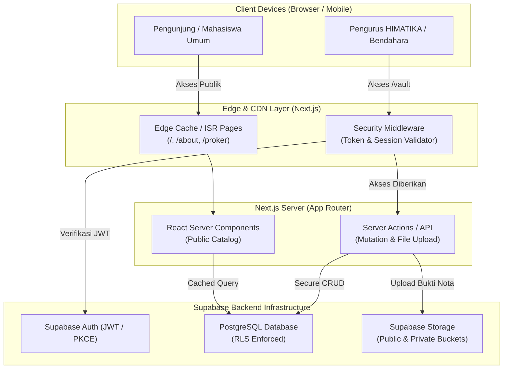
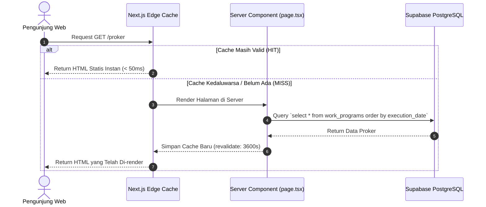
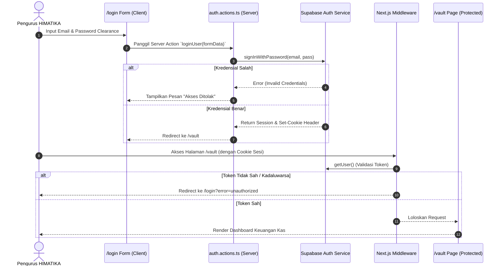
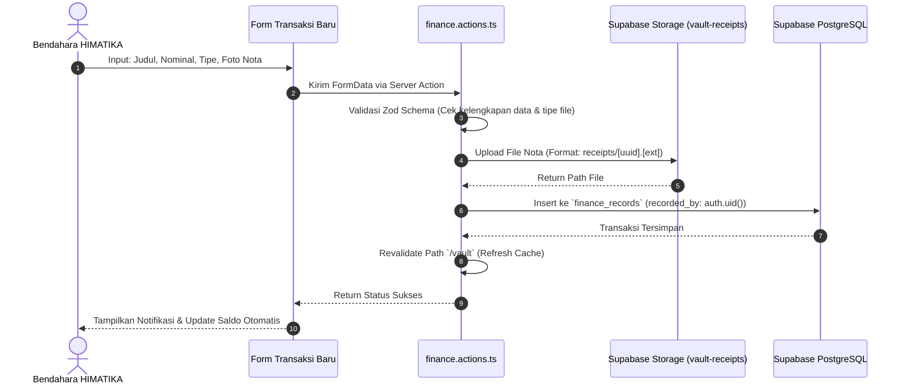

# BACKEND & SYSTEM ARCHITECTURE: HIMATIKA WEB REVAMP
> **Dokumen Arsitektur Sistem, Desain Basis Data, Logika Bisnis, dan Keamanan**  
> **Framework:** Next.js (App Router, Server Components & Server Actions)  
> **Backend-as-a-Service:** Supabase (PostgreSQL, Supabase Auth, Storage, RLS)  
> **Deployment Target:** Vercel (Edge Network) + Supabase Cloud  

---

## 1. Filosofi & Gambaran Umum Arsitektur

Arsitektur sistem HIMATIKA dirancang dengan pola **Hybrid Jamstack & Serverless Fullstack**:
1. **Pemisahan Jalur Publik dan Privat (*Dual-Plane Architecture*)**:
   * **Public Data Plane** (Beranda, Profil, Katalog Proker): Menggunakan *Incremental Static Regeneration (ISR)* dan *React Server Components (RSC)*. Halaman di-render sebagai HTML statis di Edge CDN, sehingga kecepatan loading mendekati instan dan tidak membebani kuota request database Supabase.
   * **Private Secure Plane** (The Vault / Modul Keuangan): Menggunakan autentikasi berbasis sesi (*cookies* dengan PKCE flow), proteksi di level *Middleware*, dan validasi ketat *Row Level Security (RLS)* di database PostgreSQL.
2. **Database-Driven Security (Defense-in-Depth)**:
   * Keamanan data tidak hanya bergantung pada logika kode Next.js, melainkan dikunci langsung di level PostgreSQL menggunakan RLS. Meskipun ada celah atau API diinspeksi publik, data keuangan internal tidak akan pernah bocor.



---

## 2. Rincian Tech Stack & Peran Komponen

| Komponen | Teknologi | Peran & Tanggung Jawab |
| :--- | :--- | :--- |
| **Frontend Framework** | `Next.js 16.4.6` | Rendering SSR/Cache Components (`'use cache'`), Server Actions + validasi `Zod`, dan Turbopack. |
| **Styling & Theme** | `Tailwind CSS` | Utility classes berbasis token *dark noir*, fluid typography `clamp()`, dan CSS Grid. |
| **Animation Engine** | `GSAP` + `Lenis` | Timeline orchestrator (ScrollTrigger, SplitType, ScrambleText) dan inertial scrolling. |
| **Database Engine** | `PostgreSQL (Supabase)` | Relational schema, integrity constraints, custom stored procedures (RPC), dan triggers. |
| **Authentication** | `Supabase Auth (@supabase/ssr)` | Autentikasi berbasis email/password, manajemen JWT, dan sinkronisasi sesi via HTTP-only cookies. |
| **Object Storage** | `Supabase Storage` | Penyimpanan berkas video looping hero, poster kegiatan, dan dokumen kuitansi kas privat. |
| **Icons & Typography** | `Lucide React` + Google Fonts | Ikon grafis minimalis 1.5px stroke, font `Anton SC` & `JetBrains Mono`. |

---

## 3. Struktur Direktori & Pola Desain Kode

Menggunakan pola **Feature-Driven / Layered Architecture** di dalam Next.js App Router:

```text
himatika_web/
├── archive/                          # Backup kode & config legacy (index.html, style.css, firebase/)
├── public/image/                     # 22 foto/potret WebP (~2.68 MB) + logohima.png + kolaborasi.png
├── src/
│   ├── app/                          # Next.js App Router (16.4.6)
│   │   ├── page.tsx                  # Beranda (Hero slideshow WebP, dynamic ShowcaseSlider)
│   │   ├── about/page.tsx            # Tentang Kami (Visi, Misi, Galeri scroll animasi, Logo dinamis dari site_about)
│   │   ├── api/keep-alive/route.ts   # Keep-alive cron endpoint anti-pause Supabase (await connection())
│   │   ├── struktur/page.tsx         # Halaman Mandiri Struktur & Minimalist Circuit Diagram
│   │   ├── proker/
│   │   │   ├── page.tsx              # Katalog seluruh program kerja + Sticky Filter Bar
│   │   │   └── [slug]/page.tsx       # Rincian detail program kerja + ProkerGallery lightbox
│   │   ├── keuangan/page.tsx         # Transparansi Kas Publik (Opsi A, Filter, Pagination, CSV)
│   │   ├── contact/page.tsx          # Hubungi Kami & Formulir Pesan (insert contact_messages)
│   │   ├── login/page.tsx            # Login Pengurus (Username Jabatan / Email + Toggle Password)
│   │   ├── vault/page.tsx            # Portal Pengurus RBAC (await connection() + 5 tab modul)
│   │   ├── robots.ts                 # Crawler directives (/vault, /login, /api diblokir)
│   │   ├── sitemap.ts                # Sitemap XML dinamis dari getPublicProkers()
│   │   ├── layout.tsx                # Root Layout (metadataBase/OG, Lenis, Header, Footer)
│   │   └── globals.css               # Tailwind 4, overflow-x: clip, 3D Flip, Print LPJ
│   ├── components/
│   │   ├── auth/                     # LoginFormClient
│   │   ├── common/                   # Header, Footer, MobileDrawer, ScrambleText, SmoothScroller
│   │   ├── home/                     # HeroSection, ShowcaseSlider, ContactSection
│   │   ├── diagram/                  # OrgBlueprint (CircuitConnector + SvgBusLines), DivisionDrawer
│   │   ├── keuangan/                 # PublicFinanceClient
│   │   ├── proker/                   # ProkerCard, ProkerCoverPlaceholder, ProkerFilterBar, ProkerGallery
│   │   ├── ui/                       # CustomSelect (scrollable dropdown anti-Lenis hijacking)
│   │   └── vault/                    # VaultShellClient, FinanceVaultTab, ProkerManagerTab, DivisionManagerTab, AboutManagerTab, InboxTab
│   ├── lib/
│   │   ├── auth/session.ts           # getCurrentPengurus() & role permission guards
│   │   ├── data/
│   │   │   ├── about.ts              # Fallback konten /about (DEFAULT_SITE_ABOUT)
│   │   │   ├── organization.ts       # Fallback 9 node struktur organisasi
│   │   │   ├── flagship-proker.ts    # Fallback proker unggulan beranda
│   │   │   ├── proker.ts             # Fallback katalog program kerja
│   │   │   ├── queries.ts            # Public RSC queries ("use cache" + cacheTag + fallback)
│   │   │   └── social.ts             # Sumber tunggal tautan medsos (@himatika.trilogi)
│   │   ├── supabase/
│   │   │   ├── client.ts             # Client-side Supabase Browser Client
│   │   │   ├── public.ts             # Stateless Anon Client (aman untuk "use cache" & anon insert)
│   │   │   ├── server.ts             # Cookie-based Supabase Server Client
│   │   │   ├── storage.ts            # Shared uploadPublicAsset & removeUnusedPublicAssets
│   │   │   └── middleware.ts         # updateSession() guard /vault & header Cache-Control privat
│   │   ├── utils.ts                  # Currency, CSV exporter, WhatsApp normalizer, date formatter
│   │   └── site-url.ts               # Resolver SITE_URL kanonik (NEXT_PUBLIC_SITE_URL / VERCEL_PROJECT_PRODUCTION_URL)
│   ├── actions/                      # Next.js Server Actions (Zod + updateTag + revalidatePath)
│   │   ├── auth.actions.ts           # Login jabatan/email & logout
│   │   ├── finance.actions.ts        # CRUD transaksi kas & kuitansi vault-receipts
│   │   ├── proker.actions.ts         # CRUD proker, galeri, hapus/reset poster, & cleanup storage
│   │   ├── org.actions.ts            # Edit struktur divisi, tupoksi, & foto pengurus
│   │   ├── about.actions.ts          # Update konten /about, periode, & logo (Admin HIMATIKA)
│   │   └── contact.actions.ts        # Submit kontak publik & kelola kotak masuk (Inbox)
│   ├── types/
│   │   ├── database.types.ts
│   │   └── finance.types.ts
│   └── proxy.ts                      # Next.js 16 Proxy Route Interceptor
├── vercel.json                       # Jadwal Vercel Cron keep-alive (/api/keep-alive tiap 3 hari)
├── PROJECT.md
├── DESIGN.md
├── ARCHITECTURE.md
├── TASK.md
└── GEMINI.md
```

---

## 4. Desain Basis Data & Skema PostgreSQL (Supabase)

### 4.1 Diagram Hubungan Entitas (ERD)

```mermaid
erDiagram
    DIVISIONS ||--o{ WORK_PROGRAMS : "mengelola"
    AUTH_USERS ||--|| USER_PROFILES : "memiliki role"
    AUTH_USERS ||--o{ FINANCE_RECORDS : "mencatat"
    FINANCE_CATEGORIES ||--o{ FINANCE_RECORDS : "mengkategorikan"

    DIVISIONS {
        uuid id PK
        text code UK "PRESIDIUM, BPH_SEK, BPH_BEN, BPSDM, dll"
        text name
        text short_title
        int level
        text leader_name
        text leader_image
        jsonb leaders
        jsonb member_groups
        text[] tupoksi
        int order_index
    }

    WORK_PROGRAMS {
        uuid id PK
        text title
        text slug UK
        uuid division_id FK
        text division_code
        text status "upcoming | ongoing | completed"
        text highlight_number
        text short_desc
        text full_content
        text cover_image_url
        text[] gallery_images
        jsonb rundown
        jsonb contact_person
        boolean is_featured
    }

    USER_PROFILES {
        uuid id PK_FK "auth.users(id)"
        text full_name
        app_role role "admin | bendahara | medkraf"
        text division_code
        boolean is_active
    }

    FINANCE_CATEGORIES {
        uuid id PK
        text name
        text type "income | expense"
    }

    FINANCE_RECORDS {
        uuid id PK
        text title
        numeric amount "12, 2"
        text type "income | expense"
        uuid category_id FK
        date transaction_date
        uuid recorded_by FK "auth.users"
        text receipt_url "Private vault-receipts path"
        text notes
        timestamptz created_at
    }

    CONTACT_MESSAGES {
        uuid id PK
        text name
        text email
        text subject
        text message
        text status "unread | read | archived"
        timestamptz created_at
    }

    SITE_ABOUT {
        text id PK "'default' singleton"
        text intro_primary
        text intro_secondary
        text vision_text
        text period_label
        text logo_image_url
        jsonb missions
        timestamptz updated_at
    }
```

### 4.2 Prosedur Tersimpan & View Agregasi Keuangan

Untuk menghitung total saldo kas secara instan tanpa perlu query ratusan baris data dari client:

```sql
-- View Ringkasan Kas Otomatis (SECURITY INVOKER agar mematuhi RLS pemanggil)
create or replace view public.v_financial_summary
with (security_invoker = true) as
select
  coalesce(sum(case when type = 'income' then amount else 0 end), 0) as total_income,
  coalesce(sum(case when type = 'expense' then amount else 0 end), 0) as total_expense,
  coalesce(sum(case when type = 'income' then amount else -amount end), 0) as current_balance
from public.finance_records;

-- View Daftar Mutasi Kas Publik (Opsi A: Tanpa receipt_url, notes, recorded_by)
create or replace view public.v_public_finance_records
with (security_invoker = true) as
select
  r.id,
  r.title,
  r.amount,
  r.type,
  r.category_id,
  c.name as category_name,
  r.transaction_date,
  r.created_at
from public.finance_records r
left join public.finance_categories c on c.id = r.category_id
order by r.transaction_date desc, r.created_at desc;

-- RPC Function untuk diambil via SDK Supabase
create or replace function public.get_financial_summary()
returns table (
  total_income numeric,
  total_expense numeric,
  current_balance numeric
)
language sql
security invoker
set search_path = public
as $$
  select total_income, total_expense, current_balance
  from public.v_financial_summary;
$$;
```

---

## 5. Keamanan Sistem & Kontrol Akses (Security & RBAC)

### 5.1 Arsitektur Autentikasi (PKCE Cookie-Based)
* Menggunakan standar modern `@supabase/ssr`.
* Sesi login disimpan di dalam **HTTP-only, Secure, SameSite=Lax Cookie**. Token tidak disimpan di `localStorage` untuk mencegah serangan Cross-Site Scripting (XSS).
* RBAC ditegakkan melalui tabel `public.user_profiles` (`role`: `'admin' | 'bendahara' | 'medkraf'`) dan fungsi `public.get_my_role()` di level PostgreSQL RLS serta helper server [`session.ts`](file:///C:/Users/Haerul/himatika_web/src/lib/auth/session.ts). Login mendukung **Username Jabatan** (`admin`, `bendahara`, `medkraf` → dipetakan ke `<username>@himatika.internal` di [`auth.actions.ts`](file:///C:/Users/Haerul/himatika_web/src/actions/auth.actions.ts)) sekaligus email standar.
* Karena `cacheComponents: true` & `partialPrefetching: true` aktif di `next.config.ts`, halaman terotentikasi [`/vault`](file:///C:/Users/Haerul/himatika_web/src/app/vault/page.tsx) memanggil `await connection()` di dalam `<Suspense>` (`VaultContent`) sebelum `getCurrentPengurus()` agar `supabase.auth.getUser()` (`GoTrueClient` yang memakai `Date.now()`) berjalan di *request-time* tanpa error prerender. `next.config.ts` juga mengatur `experimental.serverActions.bodySizeLimit: "11mb"` untuk mendukung upload media hingga 5 MB/file.

### 5.2 Aturan Row Level Security (RLS) Matrix (Transparansi Kas Opsi A)

| Tabel / View / Bucket | Public (Anon) | Anggota Terotentikasi (Pengurus) | Bendahara / Admin |
| :--- | :--- | :--- | :--- |
| `divisions` | **SELECT** | **SELECT** | **ALL** |
| `work_programs` | **SELECT** | **SELECT** | **ALL** |
| `finance_categories` | **SELECT** | **SELECT** | **ALL** |
| `finance_records` | **SELECT (Kolom Publik Saja)** *(tanpa `receipt_url`, `notes`, `recorded_by`)* | **SELECT (Semua Kolom)** | **INSERT, UPDATE, DELETE** |
| `v_public_finance_records` | **SELECT** | **SELECT** | **SELECT** |
| `v_financial_summary` | **SELECT** | **SELECT** | **SELECT** |
| Bucket `vault-receipts` | *DENIED* | **SELECT / UPLOAD** | **ALL** |

### 5.3 Implementasi RLS Policy & Column-Level Privileges (SQL)

```sql
-- 1. Enable RLS pada seluruh tabel
alter table divisions enable row level security;
alter table work_programs enable row level security;
alter table finance_categories enable row level security;
alter table finance_records enable row level security;

-- 2. Akses Publik (Tanpa Login) - Termasuk Transparansi Kas Opsi A
create policy "Public Read Divisions" on divisions for select using (true);
create policy "Public Read Proker" on work_programs for select using (true);

create policy "Public Read Kategori Kas"
on finance_categories for select
to anon
using (true);

create policy "Public Read Transparansi Kas"
on finance_records for select
to anon
using (true);

-- Batasi kolom anon pada finance_records (sembunyikan receipt_url, notes, recorded_by)
revoke all on finance_records from anon;
grant select (id, title, amount, type, category_id, transaction_date, created_at)
on finance_records to anon;

-- 3. Akses Terotentikasi (Pengurus yang Berhasil Login)
create policy "Pengurus Read Kategori Kas"
on finance_categories for select
to authenticated
using (true);

create policy "Pengurus Read Catatan Kas"
on finance_records for select
to authenticated
using (true);

-- 4. Hak Tulis Khusus Pengurus (Insert Catatan Kas & Upload Nota)
create policy "Pengurus Insert Catatan Kas"
on finance_records for insert
to authenticated
with check (auth.uid() = recorded_by);
```

### 5.4 Arsitektur Supabase Storage

Sistem menggunakan 2 Bucket terpisah dengan tingkat keamanan berbeda:

1. **Bucket `public-assets` (Public)**:
   * Menyimpan logo, foto kegiatan/poster proker (`prokers/...`), foto pimpinan/koordinator divisi (`divisions/...`), dan video teaser looping.
   * Siapapun dapat membaca file ini melalui CDN Supabase; hak upload/update/delete terbatas untuk role `medkraf` dan `admin` via RLS `storage.objects`.
2. **Bucket `vault-receipts` (Private)**:
   * Menyimpan foto struk belanja, nota, dan bukti transfer dana kas.
   * File tidak memiliki URL publik. Pengunjung yang tidak login tidak bisa menebak URL file.
   * Hanya user yang memiliki token otentikasi aktif yang dapat mengunduh atau menghasilkan *Signed URL* (berlaku 60 detik) untuk melihat kuitansi.

---

## 6. Logika Backend & Alur Data (Data Flow Sequences)

### 6.1 Alur 1: Mengambil Data Program Kerja Publik (Caching & ISR)



### 6.2 Alur 2: Login Pengurus & Proteksi Rute `/vault`



### 6.3 Alur 3: Pencatatan Transaksi Kas Baru & Upload Bukti Nota



---

## 7. Optimasi Kinerja, Caching, & Skalabilitas

1. **Hemat Kuota Supabase Free-Tier & Cache Next.js 16**:
   * Halaman publik (`/`, `/proker`, `/proker/[slug]`, `/struktur`, `/keuangan`, `/about`, dan `/sitemap.xml`) memakai Next.js 16 Cache Components (`"use cache"` + `cacheLife("minutes")` + `cacheTag`), di-invalidate instan oleh Server Actions lewat `updateTag()` + `revalidatePath()`. Halaman privat `/vault` memanggil `await connection()` di dalam `<Suspense>` untuk SSR per-request.
   * **Anti-Pause Supabase Free Plan (Target Fase 8)**: Project Free Plan otomatis di-*pause* setelah 7 hari tanpa aktivitas; pada Fase 8 ditambahkan `/api/keep-alive` (`await connection()` + query ringan ke `divisions`) dan `vercel.json` cron (`0 0 */3 * *`).
2. **Optimasi Aset Media & SEO (Tuntas Fase 7)**:
   * 22 aset gambar lokal `public/image/` dikompresi ke `.webp` via `sharp` (`11.884 KB` → `2.679 KB`), ditambah `images.formats: ["image/avif", "image/webp"]` pada `next.config.ts`.
   * Gambar `public-assets` yang diganti atau dihapus via `/vault` (proker & `/about`) dibersihkan otomatis melalui `src/lib/supabase/storage.ts`.
   * Routing guard & header privat dijalankan lewat konvensi Next.js 16 `src/proxy.ts` (mengecualikan `sitemap.xml`, `robots.txt`, dan file statis).
3. **Optimasi Database Indexing**:
   * Index aktif mencakup `idx_proker_status`, `idx_proker_division`, `idx_finance_date`, serta `idx_contact_messages_created (created_at desc)`.

---

## 8. Panduan Integrasi Lingkungan (Environment Variables)

File `.env.local` yang dibutuhkan oleh sistem:

```env
# URL dan Kunci Publik Supabase (Aman diakses di browser)
NEXT_PUBLIC_SUPABASE_URL=https://<project-ref>.supabase.co
NEXT_PUBLIC_SUPABASE_ANON_KEY=eyJhbGciOi...

# Kunci Rahasia Server (Opsional — tidak diperlukan pada arsitektur SSR+RLS saat ini)
# SUPABASE_SERVICE_ROLE_KEY=eyJhbGciOi...

# Metadata Situs
NEXT_PUBLIC_SITE_URL=http://localhost:3000
```

---

## 9. Status Dokumen
* Dokumen ini menjadi pedoman mutlak arsitektur backend, alur data, dan standar keamanan data kas HIMATIKA.
* Setiap penambahan fitur baru (seperti modul pemilihan raya, absensi, atau blog) wajib mengikuti pola arsitektur layer di atas.
