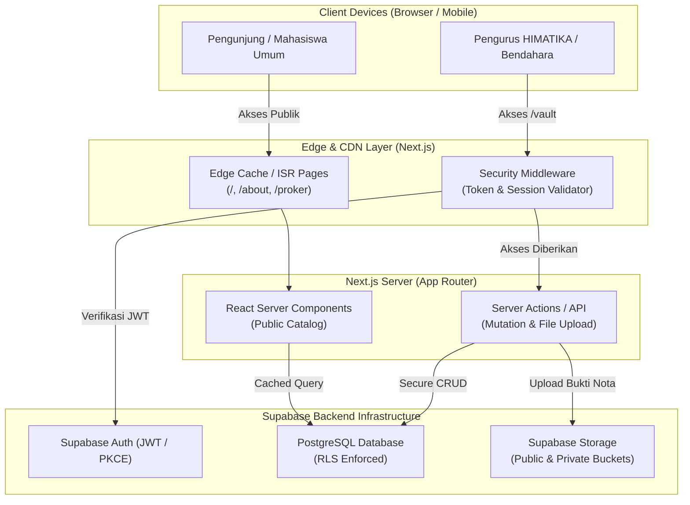
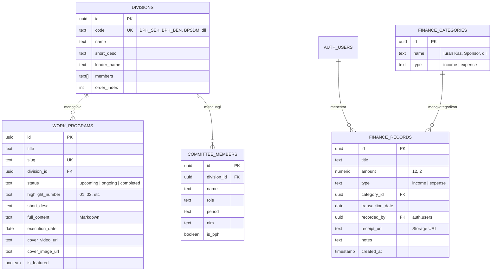
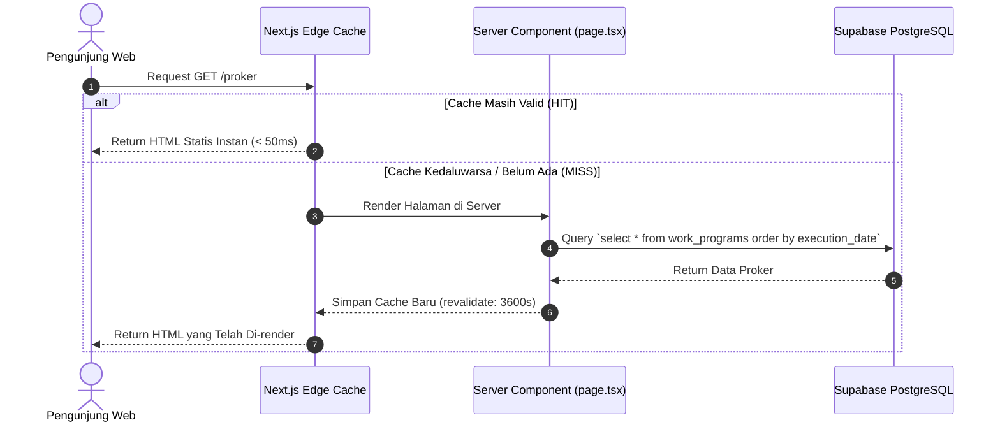
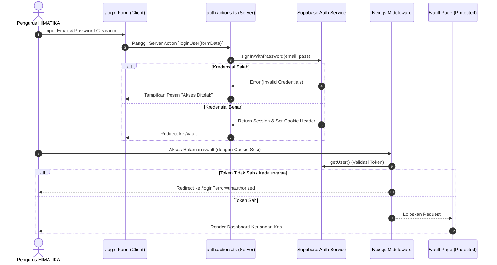
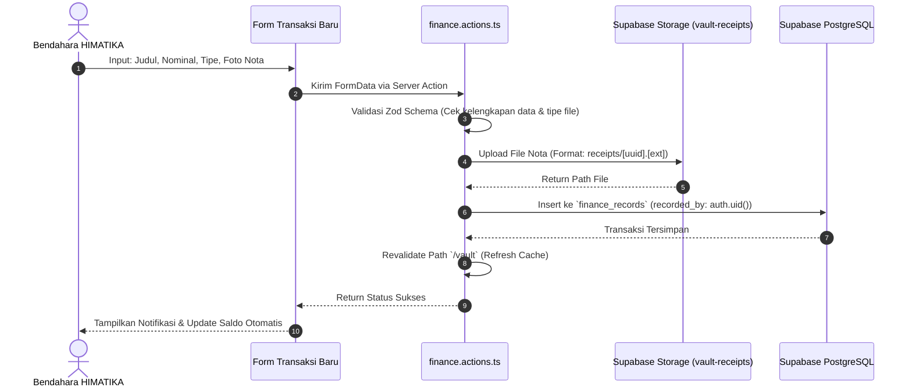

# BACKEND & SYSTEM ARCHITECTURE: HIMATIKA WEB REVAMP
> **Dokumen Arsitektur Sistem, Desain Basis Data, Logika Bisnis, dan Keamanan**  
> **Framework:** Next.js (App Router, Server Components & Server Actions)  
> **Backend-as-a-Service:** Supabase (PostgreSQL, Supabase Auth, Storage, RLS)  
> **Deployment Target:** Vercel / Firebase Hosting + Supabase Cloud  

---

## 1. Filosofi & Gambaran Umum Arsitektur

Arsitektur sistem HIMATIKA dirancang dengan pola **Hybrid Jamstack & Serverless Fullstack**:
1. **Pemisahan Jalur Publik dan Privat (*Dual-Plane Architecture*)**:
   * **Public Data Plane** (Beranda, Profil, Katalog Proker): Menggunakan *Incremental Static Regeneration (ISR)* dan *React Server Components (RSC)*. Halaman di-render sebagai HTML statis di Edge CDN, sehingga kecepatan loading mendekati instan dan tidak membebani kuota request database Supabase.
   * **Private Secure Plane** (The Vault / Modul Keuangan): Menggunakan autentikasi berbasis sesi (*cookies* dengan PKCE flow), proteksi di level *Middleware*, dan validasi ketat *Row Level Security (RLS)* di database PostgreSQL.
2. **Database-Driven Security (Defense-in-Depth)**:
   * Keamanan data tidak hanya bergantung pada logika kode Next.js, melainkan dikunci langsung di level PostgreSQL menggunakan RLS. Meskipun ada celah atau API diinspeksi publik, data keuangan internal tidak akan pernah bocor.



---

## 2. Rincian Tech Stack & Peran Komponen

| Komponen | Teknologi | Peran & Tanggung Jawab |
| :--- | :--- | :--- |
| **Frontend Framework** | `Next.js 14/15` | Rendering SSR/ISR, routing modular, Server Actions untuk mutasi data tanpa API eksternal. |
| **Styling & Theme** | `Tailwind CSS` | Utility classes berbasis token *dark noir*, fluid typography `clamp()`, dan CSS Grid. |
| **Animation Engine** | `GSAP` + `Lenis` | Timeline orchestrator (ScrollTrigger, SplitType, ScrambleText) dan inertial scrolling. |
| **Database Engine** | `PostgreSQL (Supabase)` | Relational schema, integrity constraints, custom stored procedures (RPC), dan triggers. |
| **Authentication** | `Supabase Auth (@supabase/ssr)` | Autentikasi berbasis email/password, manajemen JWT, dan sinkronisasi sesi via HTTP-only cookies. |
| **Object Storage** | `Supabase Storage` | Penyimpanan berkas video looping hero, poster kegiatan, dan dokumen kuitansi kas privat. |
| **Icons & Typography** | `Lucide React` + Google Fonts | Ikon grafis minimalis 1.5px stroke, font `Anton SC` & `JetBrains Mono`. |

---

## 3. Struktur Direktori & Pola Desain Kode

Menggunakan pola **Feature-Driven / Layered Architecture** di dalam Next.js App Router:

```text
himatika_web/
├── archive/                          # Backup kode legacy (index.html, style.css)
├── public/                           # Static assets publik
│   ├── image/                        # Logo resmi & foto kegiatan lama
│   └── videos/                       # Video loop WebM hero section
├── src/
│   ├── app/                          # Next.js App Router
│   │   ├── (public)/                 # Route Group Publik (Tanpa Autentikasi)
│   │   │   ├── page.tsx              # Beranda (Hero sinematik, featured proker slider)
│   │   │   ├── about/
│   │   │   │   └── page.tsx          # Tentang Kami & Interactive Blueprint Diagram
│   │   │   └── proker/
│   │   │       ├── page.tsx          # Katalog seluruh program kerja + Filter
│   │   │       └── [slug]/
│   │   │           └── page.tsx      # Rincian detail program kerja
│   │   ├── (auth)/                   # Route Group Autentikasi
│   │   │   ├── login/
│   │   │   │   └── page.tsx          # Terminal Login Clearance Level 1
│   │   │   └── auth-error/
│   │   │       └── page.tsx          # Tampilan alert unauthorized
│   │   ├── (private)/                # Route Group Terproteksi (Khusus Pengurus)
│   │   │   └── vault/
│   │   │       ├── page.tsx          # Dashboard ringkasan kas & buku transaksi
│   │   │       ├── transaksi-baru/   # Form input kas & upload kuitansi (Bendahara)
│   │   │       └── laporan/          # Ekspor/rekapitulasi pembukuan
│   │   ├── api/                      # Route Handlers (jika ada webhook/callback)
│   │   ├── layout.tsx                # Global Root Layout (Lenis wrapper, Navbar, Footer)
│   │   └── globals.css               # Styling global, font declaration, Tailwind base
│   ├── components/                   # Komponen Reusable
│   │   ├── common/                   # Navbar, Footer, CustomCursor, SmoothScroller
│   │   ├── ui/                       # Primitive components (Button, Badge, Drawer, Modal)
│   │   ├── home/                     # HeroVideo, ShowcaseSlider, TickerBar
│   │   ├── diagram/                  # OrgChart, NodeBox, DivisionDrawer
│   │   ├── proker/                   # ProkerCard, ProkerFilter, ProkerTimeline
│   │   └── vault/                    # StatCard, TransactionTable, ReceiptViewer, CashFlowChart
│   ├── lib/                          # Konfigurasi & Utility
│   │   ├── supabase/
│   │   │   ├── client.ts             # Client-side Supabase Browser Client
│   │   │   ├── server.ts             # Server-side Supabase Server Client (RSC & Actions)
│   │   │   └── middleware.ts         # Session refresher & route guard logic
│   │   ├── motion/                   # GSAP helper & config
│   │   └── utils.ts                  # Currency formatter (IDR), slugify, date helper
│   ├── actions/                      # Next.js Server Actions (Backend Logic)
│   │   ├── auth.actions.ts           # Login, logout, session check
│   │   ├── proker.actions.ts         # Query & filter program kerja
│   │   └── finance.actions.ts        # Create transaction, upload receipt, get summary
│   ├── types/                        # TypeScript Type Definitions
│   │   ├── database.types.ts         # Auto-generated Supabase PostgreSQL types
│   │   ├── proker.types.ts           # Domain models for work programs
│   │   └── finance.types.ts          # Domain models for financial ledger
│   └── middleware.ts                 # Next.js Root Middleware (Route Interceptor)
├── PROJECT.md                        # Blueprint Proyek
├── DESIGN.md                         # Spesifikasi Desain & UI/UX
├── ARCHITECTURE.md                   # Dokumen Arsitektur ini
└── package.json
```

---

## 4. Desain Basis Data & Skema PostgreSQL (Supabase)

### 4.1 Diagram Hubungan Entitas (ERD)



### 4.2 Prosedur Tersimpan & View Agregasi Keuangan

Untuk menghitung total saldo kas secara instan tanpa perlu query ratusan baris data dari client:

```sql
-- View Ringkasan Kas Otomatis
create or replace view v_financial_summary as
select
  coalesce(sum(case when type = 'income' then amount else 0 end), 0) as total_income,
  coalesce(sum(case when type = 'expense' then amount else 0 end), 0) as total_expense,
  coalesce(sum(case when type = 'income' then amount else -amount end), 0) as current_balance
from finance_records;

-- RPC Function untuk diambil via SDK Supabase
create or replace function get_financial_summary()
returns table (
  total_income numeric,
  total_expense numeric,
  current_balance numeric
)
language sql
security definer
as $$
  select * from v_financial_summary;
$$;
```

---

## 5. Keamanan Sistem & Kontrol Akses (Security & RBAC)

### 5.1 Arsitektur Autentikasi (PKCE Cookie-Based)
* Menggunakan standar modern `@supabase/ssr`.
* Sesi login disimpan di dalam **HTTP-only, Secure, SameSite=Lax Cookie**. Token tidak disimpan di `localStorage` untuk mencegah serangan Cross-Site Scripting (XSS).
* Setiap kali pengguna membuka halaman privat `/vault`, `middleware.ts` memverifikasi keabsahan JWT secara asinkron sebelum HTML dikirim ke browser.

### 5.2 Aturan Row Level Security (RLS) Matrix

| Tabel | Public (Anon) | Anggota Terotentikasi (Member) | Bendahara / Admin |
| :--- | :--- | :--- | :--- |
| `divisions` | **SELECT** | **SELECT** | **ALL** |
| `work_programs` | **SELECT** | **SELECT** | **ALL** |
| `finance_categories`| *DENIED* | **SELECT** | **ALL** |
| `finance_records` | *DENIED* | **SELECT** *(Read-Only Kas)* | **INSERT, UPDATE, DELETE** |

### 5.3 Implementasi RLS Policy (SQL)

```sql
-- 1. Enable RLS pada seluruh tabel
alter table divisions enable row level security;
alter table work_programs enable row level security;
alter table finance_categories enable row level security;
alter table finance_records enable row level security;

-- 2. Akses Publik (Tanpa Login)
create policy "Public Read Divisions" on divisions for select using (true);
create policy "Public Read Proker" on work_programs for select using (true);

-- 3. Akses Terotentikasi (Pengurus yang Berhasil Login)
create policy "Pengurus Read Kategori Kas" 
on finance_categories for select 
to authenticated 
using (true);

create policy "Pengurus Read Catatan Kas" 
on finance_records for select 
to authenticated 
using (true);

-- 4. Hak Tulis Khusus Pengurus (Insert Catatan Kas & Upload Nota)
create policy "Pengurus Insert Catatan Kas" 
on finance_records for insert 
to authenticated 
with check (auth.uid() = recorded_by);
```

### 5.4 Arsitektur Supabase Storage

Sistem menggunakan 2 Bucket terpisah dengan tingkat keamanan berbeda:

1. **Bucket `public-assets` (Public)**:
   * Menyimpan logo, foto kegiatan, dan video teaser looping.
   * Siapapun dapat membaca file ini melalui CDN Supabase.
2. **Bucket `vault-receipts` (Private)**:
   * Menyimpan foto struk belanja, nota, dan bukti transfer dana kas.
   * File tidak memiliki URL publik. Pengunjung yang tidak login tidak bisa menebak URL file.
   * Hanya user yang memiliki token otentikasi aktif yang dapat mengunduh atau menghasilkan *Signed URL* (berlaku 60 detik) untuk melihat kuitansi.

---

## 6. Logika Backend & Alur Data (Data Flow Sequences)

### 6.1 Alur 1: Mengambil Data Program Kerja Publik (Caching & ISR)



### 6.2 Alur 2: Login Pengurus & Proteksi Rute `/vault`



### 6.3 Alur 3: Pencatatan Transaksi Kas Baru & Upload Bukti Nota



---

## 7. Optimasi Kinerja, Caching, & Skalabilitas

1. **Hemat Kuota Supabase Free-Tier**:
   * Halaman katalog proker dan profil ormawa menggunakan strategi *stale-while-revalidate*. Query ke database Supabase hanya terjadi ketika ada update atau per jam, bukan pada setiap kunjungan mahasiswa.
2. **Optimasi Aset Multimedia di Edge**:
   * Gambar kegiatan yang diunggah ke storage di-*transform* melalui URL CDN Supabase:
     * Rasio diperkecil otomatis dan dikonversi ke format WebP generasi baru.
3. **Optimasi Database Indexing**:
   * Penambahan index pada kolom yang sering difilter:
     ```sql
     create index idx_proker_status on work_programs(status);
     create index idx_proker_division on work_programs(division_id);
     create index idx_finance_date on finance_records(transaction_date desc);
     ```

---

## 8. Panduan Integrasi Lingkungan (Environment Variables)

File `.env.local` yang dibutuhkan oleh sistem:

```env
# URL dan Kunci Publik Supabase (Aman diakses di browser)
NEXT_PUBLIC_SUPABASE_URL=https://<project-ref>.supabase.co
NEXT_PUBLIC_SUPABASE_ANON_KEY=eyJhbGciOi...

# Kunci Rahasia Server (Hanya untuk Next.js Server - TIDAK BOLEH BOCOR KE CLIENT)
SUPABASE_SERVICE_ROLE_KEY=eyJhbGciOi...

# Metadata Situs
NEXT_PUBLIC_SITE_URL=http://localhost:3000
```

---

## 9. Status Dokumen
* Dokumen ini menjadi pedoman mutlak arsitektur backend, alur data, dan standar keamanan data kas HIMATIKA.
* Setiap penambahan fitur baru (seperti modul pemilihan raya, absensi, atau blog) wajib mengikuti pola arsitektur layer di atas.
