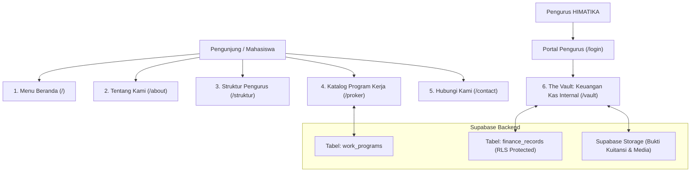
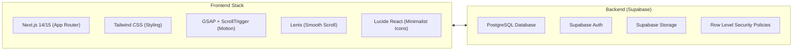

# PROJECT BLUEPRINT: HIMATIKA REVAMP 2026/2027
> **Dokumen Arsitektur, Desain, & Spesifikasi Teknis Pembaruan Website Himpunan Mahasiswa Teknik Informatika (HIMATIKA)**  
> **Status:** Fase 0 - Fase 4.5 Selesai (Aktif Dalam Pengembangan — Fase 5 Dijadwalkan Besok)  
> **Target Release:** Periode 2026/2027  

---

## 1. Ringkasan Eksekutif & Tujuan Proyek

### 1.1 Konteks Proyek
Website HIMATIKA sebelumnya merupakan website profil berbasis HTML/CSS statis konvensional dengan tampilan korporat kampus standar (terang/biru klasik). Proyek pembaruan ini bertujuan untuk melakukan **rebuild menyeluruh** (*total overhaul*) guna menciptakan identitas digital yang merepresentasikan mahasiswa Teknik Informatika: **futuristik, sinematik, berpresisi tinggi, dan berbasis teknologi terkini**.

### 1.2 Tujuan Utama (*Core Objectives*)
1. **Elevasi Identitas Visual (*Awwwards Standard*)**: Mengadopsi bahasa desain *Cinematic Brutalist-Editorial* terinspirasi dari [mikkisindhunata.com](https://mikkisindhunata.com/) dengan kanvas *Dark Obsidian*, tipografi masif (`Anton`), foto kegiatan berwarna asli (*full color*), dan animasi *fluid motion*.
2. **Representasi Struktur Modern**: Menampilkan bagan struktur kepengurusan di halaman khusus (`/struktur`) menggunakan **Interactive Circuit/Blueprint Diagram** dengan interaksi *3D Photo Flip & Glitch Reveal* saat cursor mengarah ke node pimpinan/koordinator, serta *Slide-over Drawer* untuk rincian tupoksi dan anggota.
3. **Showcase Program Kerja Terpusat**: Membangun slider proker unggulan di beranda (`/`) dan katalog program kerja interaktif komprehensif di halaman khusus (`/proker`) dengan status penayangan, filter divisi, dan panel rincian.
4. **Sistem Transparansi Keuangan Internal (The Vault / Portal Pengurus)**: Mengintegrasikan database **Supabase (PostgreSQL 17)** dengan sistem autentikasi (*Role-Based Access*) untuk pencatatan dan pelaporan kas masuk/keluar khusus pengurus HIMATIKA (Bendahara & Medkraf).
5. **Responsif Multi-Platform (100% Mobile & Desktop Ready)**: Menjamin pengalaman mulus di berbagai perangkat (Smartphone 360px-414px, Tablet, Laptop, Desktop Wide).
6. **Platform Deployment**: Menggunakan **Vercel** sebagai infrastruktur hosting serverless & Edge Network resmi.

---

## 2. Bahasa Desain & Analisis Referensi (`mikkisindhunata.com`)

### 2.1 Pilar Estetika
* **Atmosphere**: *Cinematic Dark Obsidian & Minimalist-Editorial*. Kontras tajam antara latar belakang hitam pekat dan tipografi putih bersih dengan aksen biru almamater resmi HIMATIKA (`#2563eb`).
* **Layout**: *Edge-to-Edge Composition*. Memanfaatkan ruang layar secara optimal dengan pembatas garis transparan tipis (`1px border rgba(255,255,255,0.08)`).
* **Negative Space**: Area tengah navbar dibiarkan murni kosong (*pure negative space*) untuk menghadirkan kesan mewah, teratur, dan tidak memaksakan teks terminal/AI-slop.
* **Motion Experience**:
  * **Smooth Scroll**: Menggunakan engine Lenis untuk sensasi scroll berbobot dan melayang.
  * **Text Scramble Effect**: Teks navigasi dan logo beranimasi acak/decoding karakter ala terminal saat kursor mendekat.
  * **Photo 3D Flip-Glitch Reveal**: Foto koordinator divisi muncul saat hover di diagram `/struktur`.
  * **Interactive Drawer**: Panel inspeksi meluncur dari samping (*slide-over*) saat node organisasi diklik.

### 2.2 Hierarki Tipografi
| Peran Tipografi | Font Family | Karakter & Kegunaan |
| :--- | :--- | :--- |
| **Headline / Display** | `Anton` (Google Fonts) | Huruf kapital, tebal, proporsi besar (`clamp(2.5rem, 7vw, 6rem)`). Memberikan kesan berani dan dramatis. "UNIVERSITAS TRILOGI" menggunakan aksen Biru HIMATIKA (`#2563eb`). |
| **Technical Metadata** | `JetBrains Mono` | Monospaced, tracking lebar. Digunakan untuk nomor urut (`01 / 05`), tanggal, label badge, dan data angka. |
| **Body Text** | `Poppins` / `Inter` | Bersih, keterbacaan tinggi, kontras abu-abu lembut (`#a1a1aa`) untuk deskripsi panjang (100% bebas dari AI-slop). |

### 2.3 Palet Warna Resmi (Anti AI-Slop Color System)
> [!IMPORTANT]
> Seluruh warna cyan neon buatan (`#00e5ff`) telah dieliminasi total karena memberikan kesan generik "AI-slop". Palet resmi diselaraskan dengan warna biru almamater dan logo Universitas Trilogi (`#2563eb`).

```css
:root {
  --bg-primary: #050505;        /* Deep Obsidian Canvas */
  --bg-surface: #0c0c0e;        /* Elevated Card Background */
  --text-main: #f4f4f6;         /* Pure Crisp Stark White */
  --text-muted: #a1a1aa;        /* Monospace Technical Titanium Slate */
  --accent-blue: #2563eb;       /* HIMATIKA Royal Blue (Official Almamater Blue) */
  --accent-blue-hover: #3b82f6; /* Interactive Blue Glow */
  --border-hairline: rgba(255, 255, 255, 0.08); /* 1px Hairline Precision Borders */
}
```

---

## 3. Cakupan Fitur & Spesifikasi Halaman



### 3.1 Halaman Beranda (`/`)
* **Navbar Minimalis Melayang**: Posisikan di tepi atas, transparan, menyebar kiri (`HIMATIKA TRILOGI`), tengah (Pure Negative Space), dan kanan (Menu Tautan + Tombol User Profil ke `/login`). Efek *text scramble* saat hover.
* **Hero Section Sinematik**:
  * Teks raksasa: `HIMPUNAN MAHASISWA TEKNIK INFORMATIKA UNIVERSITAS TRILOGI`.
  * Top HUD: `HIMATIKA UNIVERSITAS TRILOGI`.
  * Subtext manusiawi ramah mahasiswa: *"Ruang belajar, berkarya, dan berkembang bersama bagi mahasiswa Teknik Informatika Universitas Trilogi."*
  * Background video looping gerak lambat dalam format kompresi ringan.
  * Tombol navigasi scroll bawah: `EKSPLORASI`.
* **Featured Showcase Slider**: Slider 5 program kerja unggulan resmi dengan nomor urut (`01 / 05` s.d. `05 / 05`), progress bar linear dinamis, styling khusus badge biru untuk proker berkategori `KOLABORASI SEMUA DIVISI`, dan dukungan swipe layar sentuh.
* **Banner Struktur Organisasi**: Seksi editorial pengantar dengan tombol CTA langsung ke halaman `/struktur`.

### 3.2 Halaman Tentang Kami (`/about`)
* **Hero Identitas Resmi**: Logo HIMATIKA berukuran besar (hingga 320px) berdampingan natural dengan narasi pendirian ormawa. Bebas dari bingkai luar dan crosshair.
* **Visi Kami**: Kutipan editorial terkurasi: *"Menjadikan HIMATIKA Universitas Trilogi sebagai ruang tumbuh bagi mahasiswa Teknik Informatika yang unggul, berintegritas, inovatif, dan siap berkontribusi di industri teknologi."*
* **Empat Misi Utama**: Disajikan dalam kartu modular dengan bahasa lugas dan membumi (Akademik & Riset, Kepemimpinan & Solidaritas, Kemitraan Aktif, Inovasi & Kontribusi Nyata).
* **Bridging CTA Box**: Menghubungkan pengunjung ke `/proker` dan `/struktur`.

### 3.3 Halaman Khusus Struktur Pengurus (`/struktur`)
* **Halaman Mandiri**: Terpisah dari `/about` untuk memberikan fokus penuh pada diagram hierarki kepengurusan.
* **Interactive Blueprint / Circuit Diagram**:
  * Menghubungkan Presidium Utama (Kahim & Wakahim), BPH (Sekretaris & Bendahara), dan 6 Divisi Pelaksana.
  * **Interaksi Hover 3D Flip & Glitch Reveal**: Saat kursor mengarah ke salah satu node diagram, foto koordinator/kadiv langsung muncul dengan animasi 3D perspective flip dan scanline sweep biru elektrik.
  * **Slide-over Division Drawer**: Mengklik node mana pun membuka panel drawer samping yang memuat rincian tupoksi, susunan anggota pengurus, dan daftar proker terkait.
  * Seluruh kartu tetap 100% stabil (tidak berputar membalikkan teks) dan dapat diklik di mana saja.

### 3.4 Halaman Khusus Program Kerja (`/proker`) [FASE 5 - TARGET BESOK]
* **Katalog Komprehensif**: Menampilkan semua program kerja HIMATIKA dari arsip lama (Workshop Teknologi, T-Expo, T-Camp, Company Visit, Dukungan Karir, Kolaborasi Teknologi) ditambah proker divisi aktif.
* **Sticky Filter Bar**: Filter status (`Semua`, `Upcoming`, `Ongoing`, `Completed`) dan filter divisi/kategori (termasuk `KOLABORASI SEMUA DIVISI`).
* **Detail Card & Dynamic Route (`/proker/[slug]`)**: Menampilkan tanggal pelaksanaan, sasaran peserta, deskripsi tujuan, galeri dokumentasi foto, dan tombol pendaftaran.

### 3.5 Halaman Kontak (`/contact`)
* Rincian kontak resmi (Alamat Kampus Trilogi Kalibata, Telepon Prodi, Email resmi `himatika@trilogi.ac.id`, Jam respons operasional).
* Formulir pesan langsung terhubung ke email pengurus.

### 3.6 Modul Keuangan Internal (The Vault / `/vault`) [FASE 6]
* **Akses Terbatas (*Restricted Access*)**:
  * Halaman login `/login` untuk pengurus terdaftar (Bendahara & Medkraf).
  * Terproteksi Supabase Auth + Next.js Middleware Route Guard.
* **Dashboard Finansial**:
  * Saldo Kas Aktif, Total Pemasukan, Total Pengeluaran, pencatatan transaksi kas baru, dan upload bukti kuitansi privat.
  * **Tabel Transaksi Kas**: Daftar arus kas masuk/keluar per tanggal, nama kegiatan/keperluan, nominal, dan penanggung jawab input.
  * **Verifikasi Bukti Kuitansi**: Dukungan upload dan preview foto nota/kuitansi digital yang disimpan di Supabase Storage (Private Bucket).

### 3.5 UI/UX Standards ("Jos Los Gandos")
* **Performa Tinggi**: Skor Google Lighthouse > 90 untuk Performance, Accessibility, dan SEO.
* **Micro-Interactions**: Transisi halaman instan, kursor magnetik di desktop, feedback sentuhan haptik/visual di mobile.
* **Dark Mode Native**: Tidak memerlukan toggle light-mode yang merusak estetika; dark-mode dibangun secara permanen dan nyaman di mata (ramah layar OLED).

---

## 4. Spesifikasi Arsitektur Teknologi (Tech Stack)



* **Core Framework**: **Next.js (App Router)**
  * Memungkinkan halaman publik di-render dengan efisiensi tinggi (Server Components / ISR), sementara dashboard keuangan diamankan di level server menggunakan `@supabase/ssr`.
* **CSS Engine**: **Tailwind CSS**
  * Memudahkan penggunaan utilitas tipografi dinamis, flex/grid modern, dan custom theme dark noir.
* **Animasi & Interaksi**: **GSAP (ScrollTrigger, SplitType) + Lenis**
  * Standar industri untuk motion web kreatif kelas dunia.
* **Database & Cloud Services**: **Supabase**
  * Menggantikan Firebase sebelumnya. Menyediakan database relasional PostgreSQL, otentikasi aman, dan media storage.

---

## 5. Perancangan Skema Database (Supabase DDL)

Berikut rancangan skrip migrasi SQL siap pakai untuk Supabase:

```sql
-- ========================================================
-- 1. EXTENSIONS & ENUMS
-- ========================================================
create extension if not exists "uuid-ossp";

create type proker_status as enum ('upcoming', 'ongoing', 'completed');
create type finance_type as enum ('income', 'expense');

-- ========================================================
-- 2. TABEL STRUKTUR & ORGANISASI (Untuk Diagram)
-- ========================================================
create table divisions (
  id uuid primary key default gen_random_uuid(),
  code text unique not null,               -- misal: 'BPH', 'LITBANG', 'KOMINFO'
  name text not null,                      -- misal: 'Divisi Penelitian & Pengembangan'
  short_desc text,
  leader_name text not null,               -- Nama Ketua Divisi
  members text[] default '{}',             -- Array nama anggota
  order_index int default 0
);

-- ========================================================
-- 3. TABEL PROGRAM KERJA (Untuk Katalog /proker)
-- ========================================================
create table work_programs (
  id uuid primary key default gen_random_uuid(),
  title text not null,
  slug text unique not null,
  division_id uuid references divisions(id) on delete set null,
  status proker_status default 'upcoming',
  highlight_number text,                   -- misal: '01', '02'
  short_desc text not null,
  full_content text,                       -- Format Markdown untuk detail acara
  execution_date date,
  cover_video_url text,                    -- Video teaser loop (WebM)
  cover_image_url text,
  is_featured boolean default false,       -- Tampil di slider beranda
  created_at timestamp with time zone default now()
);

-- ========================================================
-- 4. TABEL KEUANGAN INTERNAL (The Vault - RLS Protected)
-- ========================================================
create table finance_categories (
  id uuid primary key default gen_random_uuid(),
  name text not null,                      -- misal: 'Iuran Kas', 'Sponsor', 'Konsumsi'
  type finance_type not null
);

create table finance_records (
  id uuid primary key default gen_random_uuid(),
  title text not null,                     -- Keterangan transaksi
  amount numeric(12, 2) not null,          -- Jumlah uang
  type finance_type not null,              -- 'income' atau 'expense'
  category_id uuid references finance_categories(id) on delete set null,
  transaction_date date not null,
  recorded_by uuid references auth.users(id),
  receipt_url text,                        -- URL bukti kuitansi di Supabase Storage
  notes text,
  created_at timestamp with time zone default now()
);

-- ========================================================
-- 5. ROW LEVEL SECURITY (RLS) POLICIES
-- ========================================================
-- Public dapat melihat divisi dan proker
alter table divisions enable row level security;
create policy "Divisi dapat dibaca publik" on divisions for select using (true);

alter table work_programs enable row level security;
create policy "Proker dapat dibaca publik" on work_programs for select using (true);

-- Keuangan HANYA dapat dibaca oleh pengguna login (pengurus)
alter table finance_records enable row level security;
create policy "Data kas hanya untuk pengurus terdaftar" 
on finance_records for all 
to authenticated 
using (true)
with check (true);

-- ========================================================
-- 6. SEED DATA DIVISI RESMI HIMATIKA
-- ========================================================
insert into divisions (code, name, leader_name, short_desc, order_index) values
  ('BPH_SEK', 'Sekretaris', 'TBA', 'Tata kelola administrasi, kearsipan, dan persuratan organisasi.', 1),
  ('BPH_BEN', 'Bendahara', 'TBA', 'Pengelolaan kas, perencanaan anggaran, dan transparansi keuangan.', 2),
  ('BPSDM', 'Badan Pengembangan Sumber Daya Manusia', 'TBA', 'Kaderisasi, pembinaan karakter, dan peningkatan kapasitas internal pengurus.', 3),
  ('HUMAS', 'Hubungan Masyarakat', 'TBA', 'Menjalin relasi strategis dengan pihak eksternal, ormawa lain, dan industri teknologi.', 4),
  ('RISET', 'Riset dan Keilmuan', 'TBA', 'Pengembangan akademik, riset teknologi, kajian ilmiah, dan persiapan kompetisi IT.', 5),
  ('PMB', 'Pengembangan Minat dan Bakat', 'TBA', 'Fasilitasi minat non-akademik mahasiswa seperti olahraga, seni, dan komunitas hobi/esports.', 6),
  ('SARLOG', 'Sarana dan Logistik', 'TBA', 'Pengelolaan inventaris, fasilitas kesekretariatan, dan kebutuhan operasional acara.', 7),
  ('MEDKRAF', 'Media Kreatif', 'TBA', 'Branding visual, desain grafis, pengelolaan media sosial resmi, dan dokumentasi multimedia.', 8)
on conflict (code) do nothing;
```

---

## 6. Struktur Direktori Proyek Baru

Struktur direktori standar Next.js yang disiapkan untuk menampung seluruh fitur:

```text
himatika_web/
├── archive/                     # File web lama (index.html, style.css) disimpan sebagai cadangan
│   ├── index.html
│   └── style/
├── public/                      # Asset statis yang dapat diakses publik
│   ├── image/                   # Foto dokumentasi lama & logo HIMATIKA
│   │   ├── Logo Himatika.png
│   │   ├── t-camp.jpg
│   │   └── ...
│   ├── fonts/                   # Font lokal (Anton SC, JetBrains Mono)
│   └── videos/                  # Video loop ringkas untuk hero section
├── src/
│   ├── app/                     # Next.js App Router
│   │   ├── (public)/            # Route Group Publik
│   │   │   ├── page.tsx         # Halaman Beranda (Cinematic Hero + Teaser Proker)
│   │   │   ├── about/           # Halaman Tentang Kami & Interactive Diagram
│   │   │   └── proker/          # Halaman Khusus Katalog Proker
│   │   │       ├── page.tsx
│   │   │       └── [slug]/      # Detail satu program kerja
│   │   ├── (auth)/              # Route Group Autentikasi
│   │   │   └── login/           # Halaman Login Terminal Pengurus
│   │   ├── (private)/           # Route Group Khusus Internal
│   │   │   └── vault/           # Dashboard Keuangan Kas Himatika
│   │   ├── api/                 # Endpoint integrasi jika diperlukan
│   │   ├── layout.tsx           # Global Layout (Navbar, Smooth Scroll Wrapper)
│   │   └── globals.css          # Tailwind CSS & Keyframes
│   ├── components/
│   │   ├── ui/                  # Komponen UI Dasar (Buttons, Badges, Drawers)
│   │   ├── home/                # Komponen Beranda (HeroVideo, ScrambleHeader)
│   │   ├── diagram/             # Interactive Org Chart Component
│   │   ├── proker/              # ProkerCard, ProkerFilter, ProkerModal
│   │   └── vault/               # CashflowChart, TransactionTable, ReceiptViewer
│   ├── lib/
│   │   ├── supabase/            # Client & Server Helper Supabase
│   │   │   ├── client.ts
│   │   │   └── server.ts
│   │   └── motion/              # Konfigurasi GSAP & Lenis
│   └── types/                   # TypeScript interfaces (Database Types)
├── PROJECT.md                   # Dokumen Blueprint ini
└── package.json
```

---

## 7. Rencana Tahapan Eksekusi (Roadmap Milestones)

| Fase | Nama Fase | Fokus Pengerjaan |
| :--- | :--- | :--- |
| **Fase 1** | **Fondasi & Inisialisasi** | Inisialisasi Next.js (App Router), integrasi Tailwind, konfigurasi font Google (`Anton SC` & `JetBrains Mono`), dan integrasi Lenis smooth scroll. |
| **Fase 2** | **Landing Page Sinematik** | Pengerjaan Header fixed dengan efek *text scramble*, Hero section dengan video loop background, dan teaser carousel proker. |
| **Fase 3** | **About & Interactive Diagram** | Pembangunan halaman About Us dan modul visual diagram struktur organisasi (Node hierarchy tanpa foto) yang responsif. |
| **Fase 4** | **Katalog Proker & Supabase** | Pembuatan halaman `/proker`, penghubungan data dinamis dari Supabase `work_programs`, dan sistem drawer detail proker. |
| **Fase 5** | **The Vault (Keuangan Kas Internal)** | Pembuatan antarmuka login terminal, konfigurasi Supabase Auth & RLS, form input kas masuk/keluar, dan dashboard pelaporan. |
| **Fase 6** | **Polish, Mobile Audit, & Launch** | Audit performa di berbagai smartphone, kompresi aset gambar/video, uji coba keamanan data kas, dan deploy. |

---

## 8. Status & Kemajuan Proyek Terkini

Status Kesiapan & Verifikasi Sistem:
* [x] **Daftar Divisi Resmi**: Sudah terkonfirmasi dan terintegrasi 8 entitas resmi HIMATIKA + Presidium Utama.
* [x] **Runtime Lokal**: Node.js LTS (`v24.20.0`) dan NPM (`v11.19.0`) aktif di mesin lokal.
* [x] **Koneksi Supabase MCP**: Terhubung ke proyek **`Website_Himatika`** (`urlpknogetgjfmwdbymk`).
* [x] **Skema Basis Data Supabase**: 4 tabel (`divisions`, `work_programs`, `finance_categories`, `finance_records`), RLS security, 2 storage bucket (`public-assets`, `vault-receipts`), database view, dan RPC function berhasil dideploy.
* [x] **Platform Hosting Terpilih**: Vercel (Edge Serverless).
* [x] **FASE 0 Selesai (Environment & Database Setup)**: Database DDL, RLS, seed data 8 divisi & kategori kas, storage bucket.
* [x] **FASE 1 Selesai (Fondasi Next.js & Desain Sistem)**: Next.js 16 (Turbopack, TypeScript, Tailwind 4), Google Fonts (`Anton`, `JetBrains_Mono`, `Poppins`), Supabase SSR helpers, middleware route guard.
* [x] **FASE 2 Selesai (Komponen Global & Navigasi)**: `SmoothScroller` (Lenis), `ScrambleText`, `Header` (Pure negative space di tengah, user profile icon ke `/login`), `MobileDrawer` (Fullscreen brutalist), `Footer` (Technical dossier coordinates).
* [x] **FASE 3 Selesai (Halaman Beranda Sinematik)**: Slideshow latar belakang foto kegiatan asli berwarna (*full color*), headline masif Anton dengan "UNIVERSITAS TRILOGI" aksen Biru HIMATIKA (`#2563eb`), Showcase Slider proker split-screen dengan sentuhan gestur swipe, dan Quick Metrics blueprint.
* [x] **FASE 4 Selesai (Tentang Kami & Interactive Org Blueprint)**: Narasi editorial sejarah HIMATIKA sejak 2015, Visi & Misi spesifikasi teknis 4 pilar, 4 Nilai Dasar, Interactive Org Blueprint (SVG circuit bus & node tree tanpa foto personal anggota), dan slide-over `DivisionDrawer` interaktif.
* [ ] **Langkah Selanjutnya**: Siap eksekusi **FASE 5 (Katalog Program Kerja Dedikasi `/proker` dengan Sticky Filter Status & Divisi)**.

*(Dokumen ini diperbarui secara berkala sebagai sumber kebenaran teknis proyek).*
