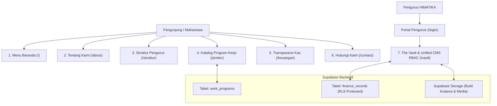
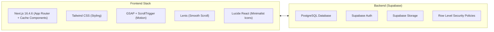

# PROJECT BLUEPRINT: HIMATIKA REVAMP 2026/2027
> **Dokumen Arsitektur, Desain, & Spesifikasi Teknis Pembaruan Website Himpunan Mahasiswa Teknik Informatika (HIMATIKA)**  
> **Status:** Fase 0 – Fase 7 (Siap Audit Lighthouse, Commit Git, & Fase 8 Deploy Vercel)  
> **Target Release:** Periode 2026/2027  

---

## 1. Ringkasan Eksekutif & Tujuan Proyek

### 1.1 Konteks Proyek
Website HIMATIKA sebelumnya merupakan website profil berbasis HTML/CSS statis konvensional dengan tampilan korporat kampus standar (terang/biru klasik). Proyek pembaruan ini bertujuan untuk melakukan **rebuild menyeluruh** (*total overhaul*) guna menciptakan identitas digital yang merepresentasikan mahasiswa Teknik Informatika: **futuristik, sinematik, berpresisi tinggi, dan berbasis teknologi terkini**.

### 1.2 Tujuan Utama (*Core Objectives*)
1. **Elevasi Identitas Visual (*Awwwards Standard*)**: Mengadopsi bahasa desain *Cinematic Brutalist-Editorial* terinspirasi dari [mikkisindhunata.com](https://mikkisindhunata.com/) dengan kanvas *Dark Obsidian*, tipografi masif (`Anton`), foto kegiatan berwarna asli (*full color*), dan animasi *fluid motion*.
2. **Representasi Struktur Modern**: Menampilkan bagan struktur kepengurusan di halaman khusus (`/struktur`) menggunakan **Interactive Circuit/Blueprint Diagram** dengan interaksi *3D Photo Flip & Glitch Reveal* saat cursor mengarah ke node pimpinan/koordinator, serta *Slide-over Drawer* untuk rincian tupoksi dan anggota.
3. **Showcase Program Kerja Terpusat**: Membangun slider proker unggulan di beranda (`/`) dan katalog program kerja interaktif komprehensif di halaman khusus (`/proker`) dengan status penayangan, filter divisi, dan panel rincian.
4. **Sistem Transparansi Keuangan Internal (The Vault / Portal Pengurus)**: Mengintegrasikan database **Supabase (PostgreSQL 17)** dengan sistem autentikasi (*Role-Based Access*) untuk pencatatan dan pelaporan kas masuk/keluar khusus pengurus HIMATIKA (Bendahara & Medkraf).
5. **Responsif Multi-Platform (100% Mobile & Desktop Ready)**: Menjamin pengalaman mulus di berbagai perangkat (Smartphone 360px-414px, Tablet, Laptop, Desktop Wide).
6. **Platform Deployment**: Menggunakan **Vercel** sebagai infrastruktur hosting serverless & Edge Network resmi.

---

## 2. Bahasa Desain & Analisis Referensi (`mikkisindhunata.com`)

### 2.1 Pilar Estetika
* **Atmosphere**: *Cinematic Dark Obsidian & Minimalist-Editorial*. Kontras tajam antara latar belakang hitam pekat dan tipografi putih bersih dengan aksen biru almamater resmi HIMATIKA (`#2563eb`).
* **Layout**: *Edge-to-Edge Composition*. Memanfaatkan ruang layar secara optimal dengan pembatas garis transparan tipis (`1px border rgba(255,255,255,0.08)`).
* **Negative Space**: Area tengah navbar dibiarkan murni kosong (*pure negative space*) untuk menghadirkan kesan mewah, teratur, dan tidak memaksakan teks terminal/AI-slop.
* **Motion Experience**:
  * **Smooth Scroll**: Menggunakan engine Lenis untuk sensasi scroll berbobot dan melayang.
  * **Text Scramble Effect**: Teks navigasi dan logo beranimasi acak/decoding karakter ala terminal saat kursor mendekat.
  * **Photo 3D Flip-Glitch Reveal**: Foto koordinator divisi muncul saat hover di diagram `/struktur`.
  * **Interactive Drawer**: Panel inspeksi meluncur dari samping (*slide-over*) saat node organisasi diklik.

### 2.2 Hierarki Tipografi
| Peran Tipografi | Font Family | Karakter & Kegunaan |
| :--- | :--- | :--- |
| **Headline / Display** | `Anton` (Google Fonts) | Huruf kapital, tebal, proporsi besar (`clamp(2.5rem, 7vw, 6rem)`). Memberikan kesan berani dan dramatis. "UNIVERSITAS TRILOGI" menggunakan aksen Biru HIMATIKA (`#2563eb`). |
| **Technical Metadata** | `JetBrains Mono` | Monospaced, tracking lebar. Digunakan untuk nomor urut (`01 / 05`), tanggal, label badge, dan data angka. |
| **Body Text** | `Poppins` / `Inter` | Bersih, keterbacaan tinggi, kontras abu-abu lembut (`#a1a1aa`) untuk deskripsi panjang (100% bebas dari AI-slop). |

### 2.3 Palet Warna Resmi (Anti AI-Slop Color System)
> [!IMPORTANT]
> Seluruh warna cyan neon buatan (`#00e5ff`) telah dieliminasi total karena memberikan kesan generik "AI-slop". Palet resmi diselaraskan dengan warna biru almamater dan logo Universitas Trilogi (`#2563eb`).

```css
:root {
  --bg-primary: #050505;        /* Deep Obsidian Canvas */
  --bg-surface: #0c0c0e;        /* Elevated Card Background */
  --text-main: #f4f4f6;         /* Pure Crisp Stark White */
  --text-muted: #a1a1aa;        /* Monospace Technical Titanium Slate */
  --accent-blue: #2563eb;       /* HIMATIKA Royal Blue (Official Almamater Blue) */
  --accent-blue-hover: #3b82f6; /* Interactive Blue Glow */
  --border-hairline: rgba(255, 255, 255, 0.08); /* 1px Hairline Precision Borders */
}
```

---

## 3. Cakupan Fitur & Spesifikasi Halaman



### 3.1 Halaman Beranda (`/`)
* **Hero Section**: Headline masif `TEKNIK INFORMATIKA` + `UNIVERSITAS TRILOGI` dengan warna aksen Biru HIMATIKA (`#2563eb`).
  * Top HUD kontras tinggi (`text-zinc-200` + `drop-shadow`) bertuliskan `HIMATIKA UNIVERSITAS TRILOGI` & judul slide aktif, plus `JAKARTA SELATAN` di bawah.
  * Subtext manusiawi ramah mahasiswa: *"Ruang belajar, berkarya, dan berkembang bersama bagi mahasiswa Teknik Informatika Universitas Trilogi."*
  * Background slideshow foto kegiatan asli full-color terkompresi `.webp` dengan render progresif (hanya slide aktif & transisi keluar) untuk *LCP* cepat.
  * Tombol navigasi scroll bawah: `EKSPLORASI`.
* **Featured Showcase Slider**: Slider dinamis untuk seluruh program kerja bertanda unggulan (`is_featured`) dengan nomor urut (`01 / NN`), progress bar linear dinamis, styling khusus badge biru untuk `KOLABORASI HIMPUNAN`, placeholder editorial jika tanpa poster (`ProkerCoverPlaceholder`), dan dukungan swipe layar sentuh.
* **Banner Struktur Organisasi**: Seksi editorial pengantar dengan tombol CTA langsung ke halaman `/struktur`.

### 3.2 Halaman Tentang Kami (`/about`) [DINAMIS - `site_about`]
* **Hero Identitas Resmi**: Logo HIMATIKA berukuran besar (hingga 320px, dapat diganti/direset dari `/vault`) berdampingan natural dengan narasi pendirian ormawa yang diambil dari tabel Supabase `site_about`.
* **Visi & Periode Aktif**: Kutipan visi dinamis beserta label `PERIODE 2026/2027` yang ikut tersinkron ke halaman `/struktur`.
* **Misi Organisasi**: Disajikan dalam kartu modular dinamis (1–8 poin misi) dengan bahasa lugas dan membumi.
* **Bridging CTA Box**: Menghubungkan pengunjung ke `/proker` dan `/struktur`.

### 3.3 Halaman Khusus Struktur Pengurus (`/struktur`)
* **Halaman Mandiri**: Terpisah dari `/about` untuk memberikan fokus penuh pada diagram hierarki kepengurusan.
* **Interactive Blueprint / Circuit Diagram**:
  * Menghubungkan **Pimpinan Himpunan** (kode internal `PRESIDIUM`: Kahim & Wakahim), BPH (Sekretaris & Bendahara), dan 6 Divisi Pelaksana melalui jalur sirkuit SVG minimalis selaras kolom di tiap breakpoint (`CircuitConnector` + `SvgBusLines`).
  * **Interaksi Hover 3D Flip & Glitch Reveal**: Saat kursor mengarah ke salah satu node diagram, foto koordinator/kadiv langsung muncul dengan animasi 3D perspective flip dan scanline sweep biru elektrik (di mobile foto langsung terlihat).
  * **Slide-over Division Drawer**: Mengklik node mana pun membuka panel drawer samping yang memuat rincian tupoksi, susunan anggota pengurus, dan daftar proker terkait (tersinkron otomatis dengan `work_programs`).
  * Seluruh kartu tetap 100% stabil (tidak berputar membalikkan teks) dan dapat diklik di mana saja.

### 3.4 Halaman Khusus Program Kerja (`/proker`) [SELESAI - FASE 5]
* **Katalog Komprehensif**: Menampilkan semua program kerja HIMATIKA dari database `work_programs` (dengan seed fallback lokal `src/lib/data/proker.ts`).
* **Sticky Filter Bar**: Filter status (`Semua`, `Akan Datang`, `Sedang Berjalan`, `Selesai`) dan filter divisi/kategori (termasuk `KOLABORASI HIMPUNAN` & `PIMPINAN HIMPUNAN`). Memakai `overflow-x: clip` pada body agar sticky bar menempel mulus di desktop & mobile.
* **Detail Card & Dynamic Route (`/proker/[slug]`)**: Menampilkan tanggal pelaksanaan, lokasi, sasaran peserta, deskripsi & tujuan, rundown kegiatan, galeri dokumentasi foto lightbox (otomatis tersembunyi jika galeri 0 foto), tombol kontak WhatsApp panitia, serta CTA pendaftaran.

### 3.5 Halaman Kontak (`/contact`) [TERHUBUNG SUPABASE]
* Rincian kontak resmi (Alamat Kampus Trilogi Kalibata, Telepon Prodi, Email resmi `himatika@trilogi.ac.id`, Jam respons operasional) dengan semantic `<h1>` di rute `/contact`.
* Formulir kirim pesan nyata terhubung ke tabel Supabase `contact_messages` (RLS `anon INSERT`) yang masuk langsung ke tab **`KOTAK MASUK`** di `/vault`.

### 3.6 Transparansi Kas Publik (`/keuangan`) & Portal Pengurus (`/vault`) [SELESAI - FASE 6 & PENYEMPURNAAN]
* **Akses Terbatas (*Restricted Access*)**:
  * Halaman login `/login` untuk pengurus terdaftar (berbasis role pada tabel `user_profiles`) dengan dukungan **Username Jabatan** atau email akun terdaftar (kredensial internal disamarkan dari dokumentasi publik), serta tombol ikon mata tampil/sembunyi kata sandi. Halaman publik transparansi kas (Opsi A) tersedia di `/keuangan` (filter bulan/tahun, pagination, & ekspor CSV).
  * Terproteksi Supabase Auth + Next.js 16 `src/proxy.ts` Route Guard.
* **Dashboard Finansial & Modul Pengurus**:
  * **Kas & Kuitansi**: Saldo Kas Aktif, Total Pemasukan, Total Pengeluaran, tambah/edit/hapus transaksi kas, preview nota privat via *Signed URL* (`vault-receipts`), ekspor CSV, dan cetak laporan LPJ.
  * **Kelola Program Kerja**: Tambah/edit/hapus proker, editor rundown & WhatsApp, multi-foto galeri dokumentasi (dapat ditambah atau dikosongkan total `0` foto), **hapus/reset poster utama**, serta pembersihan file usang otomatis di `public-assets` (`src/lib/supabase/storage.ts`). *(Checkbox UI wadah latar putih sudah dihapus dari form Vault.)*
  * **Kelola Struktur**: Edit 9 node organisasi, tupoksi, anggota, dan unggah foto pimpinan/koordinator (`public-assets`).
  * **Kelola Tentang** *(Khusus `admin`)*: Edit deskripsi profil, visi, daftar misi, label periode aktif, serta unggah/reset logo halaman `/about`.
  * **Kotak Masuk**: Kelola pesan publik dari `/contact`, filter status (`Belum Dibaca`, `Sudah Dibaca`, `Diarsipkan`), tombol balas email, ubah status & hapus (`admin`/`medkraf`; `bendahara` mode baca).

#### Matriks Hak Akses Role Pengurus (RBAC)

| Fitur / Modul | Role Bendahara | Role Medkraf | Role Admin |
| :--- | :---: | :---: | :---: |
| **Divisi (`division_code`)** | `BPH_BEN` | `MEDKRAF` | `PRESIDIUM` |
| **Lihat Ringkasan & Buku Kas** | ✅ Penuh | 👁️ Baca Saja | ✅ Penuh |
| **Tambah/Edit/Hapus Kas, Lihat Nota Privat, & Cetak LPJ** | ✅ Bisa | ❌ Tidak | ✅ Bisa |
| **Kelola Proker, Galeri, Poster, & Cleanup Storage** | ❌ Tidak | ✅ Bisa | ✅ Bisa |
| **Lihat / Kelola Kotak Masuk (`/contact` → `/vault`)** | 👁️ Baca Saja | ✅ Penuh | ✅ Penuh |
| **Edit Struktur (`/struktur`) & Halaman Tentang (`/about`)** | ❌ Tidak | ❌ Tidak | ✅ Bisa |

### 3.7 UI/UX Standards ("Jos Los Gandos")
* **Performa Tinggi**: Skor Google Lighthouse > 90 untuk Performance, Accessibility, dan SEO.
* **Micro-Interactions**: Transisi halaman instan, kursor magnetik di desktop, feedback sentuhan haptik/visual di mobile.
* **Dark Mode Native**: Tidak memerlukan toggle light-mode yang merusak estetika; dark-mode dibangun secara permanen dan nyaman di mata (ramah layar OLED).

---

## 4. Spesifikasi Arsitektur Teknologi (Tech Stack)



* **Core Framework**: **Next.js (App Router)**
  * Memungkinkan halaman publik di-render dengan efisiensi tinggi (Server Components / ISR), sementara dashboard keuangan diamankan di level server menggunakan `@supabase/ssr`.
* **CSS Engine**: **Tailwind CSS**
  * Memudahkan penggunaan utilitas tipografi dinamis, flex/grid modern, dan custom theme dark noir.
* **Animasi & Interaksi**: **GSAP (ScrollTrigger, SplitType) + Lenis**
  * Standar industri untuk motion web kreatif kelas dunia.
* **Database & Cloud Services**: **Supabase**
  * Menggantikan Firebase sebelumnya. Menyediakan database relasional PostgreSQL, otentikasi aman, dan media storage.

---

## 5. Perancangan Skema Database (Supabase DDL)

Berikut rancangan skrip migrasi SQL siap pakai untuk Supabase:

```sql
-- ========================================================
-- 1. EXTENSIONS & ENUMS
-- ========================================================
create extension if not exists "uuid-ossp";

create type proker_status as enum ('upcoming', 'ongoing', 'completed');
create type finance_type as enum ('income', 'expense');

-- ========================================================
-- 2. TABEL STRUKTUR & ORGANISASI (Untuk Diagram)
-- ========================================================
create table divisions (
  id uuid primary key default gen_random_uuid(),
  code text unique not null,               -- misal: 'BPH', 'LITBANG', 'KOMINFO'
  name text not null,                      -- misal: 'Divisi Penelitian & Pengembangan'
  short_desc text,
  leader_name text not null,               -- Nama Ketua Divisi
  members text[] default '{}',             -- Array nama anggota
  order_index int default 0
);

-- ========================================================
-- 3. TABEL PROGRAM KERJA (Untuk Katalog /proker)
-- ========================================================
create table work_programs (
  id uuid primary key default gen_random_uuid(),
  title text not null,
  slug text unique not null,
  division_id uuid references divisions(id) on delete set null,
  status proker_status default 'upcoming',
  highlight_number text,                   -- misal: '01', '02'
  short_desc text not null,
  full_content text,                       -- Format Markdown untuk detail acara
  execution_date date,
  cover_video_url text,                    -- Video teaser loop (WebM)
  cover_image_url text,
  is_featured boolean default false,       -- Tampil di slider beranda
  created_at timestamp with time zone default now()
);

-- ========================================================
-- 4. TABEL KEUANGAN INTERNAL (The Vault - RLS Protected)
-- ========================================================
create table finance_categories (
  id uuid primary key default gen_random_uuid(),
  name text not null,                      -- misal: 'Iuran Kas', 'Sponsor', 'Konsumsi'
  type finance_type not null
);

create table finance_records (
  id uuid primary key default gen_random_uuid(),
  title text not null,                     -- Keterangan transaksi
  amount numeric(12, 2) not null,          -- Jumlah uang
  type finance_type not null,              -- 'income' atau 'expense'
  category_id uuid references finance_categories(id) on delete set null,
  transaction_date date not null,
  recorded_by uuid references auth.users(id),
  receipt_url text,                        -- URL bukti kuitansi di Supabase Storage
  notes text,
  created_at timestamp with time zone default now()
);

-- ========================================================
-- 5. ROW LEVEL SECURITY (RLS) POLICIES
-- ========================================================
-- Public dapat melihat divisi dan proker
alter table divisions enable row level security;
create policy "Divisi dapat dibaca publik" on divisions for select using (true);

alter table work_programs enable row level security;
create policy "Proker dapat dibaca publik" on work_programs for select using (true);

-- Transparansi Kas Publik (Opsi A): Publik dapat melihat saldo & mutasi kas non-sensitif (tanpa receipt_url, notes, recorded_by)
alter table finance_categories enable row level security;
create policy "Public Read Kategori Kas" on finance_categories for select to anon using (true);
create policy "Pengurus Read Kategori Kas" on finance_categories for select to authenticated using (true);

alter table finance_records enable row level security;
create policy "Public Read Transparansi Kas" on finance_records for select to anon using (true);
create policy "Pengurus Read Catatan Kas" on finance_records for select to authenticated using (true);
create policy "Pengurus Insert Catatan Kas" on finance_records for insert to authenticated with check (auth.uid() = recorded_by);

revoke all on finance_records from anon;
grant select (id, title, amount, type, category_id, transaction_date, created_at) on finance_records to anon; 
 
 


-- ========================================================
-- 6. SEED DATA DIVISI RESMI HIMATIKA
-- ========================================================
insert into divisions (code, name, leader_name, short_desc, order_index) values
  ('BPH_SEK', 'Sekretaris', 'TBA', 'Tata kelola administrasi, kearsipan, dan persuratan organisasi.', 1),
  ('BPH_BEN', 'Bendahara', 'TBA', 'Pengelolaan kas, perencanaan anggaran, dan transparansi keuangan.', 2),
  ('BPSDM', 'Badan Pengembangan Sumber Daya Manusia', 'TBA', 'Kaderisasi, pembinaan karakter, dan peningkatan kapasitas internal pengurus.', 3),
  ('HUMAS', 'Hubungan Masyarakat', 'TBA', 'Menjalin relasi strategis dengan pihak eksternal, ormawa lain, dan industri teknologi.', 4),
  ('RISET', 'Riset dan Keilmuan', 'TBA', 'Pengembangan akademik, riset teknologi, kajian ilmiah, dan persiapan kompetisi IT.', 5),
  ('PMB', 'Pengembangan Minat dan Bakat', 'TBA', 'Fasilitasi minat non-akademik mahasiswa seperti olahraga, seni, dan komunitas hobi/esports.', 6),
  ('SARLOG', 'Sarana dan Logistik', 'TBA', 'Pengelolaan inventaris, fasilitas kesekretariatan, dan kebutuhan operasional acara.', 7),
  ('MEDKRAF', 'Media Kreatif', 'TBA', 'Branding visual, desain grafis, pengelolaan media sosial resmi, dan dokumentasi multimedia.', 8)
on conflict (code) do nothing;
```

---

## 6. Struktur Direktori Proyek Baru

Struktur direktori aktual Next.js 16 (App Router) setelah selesainya Fase 7:

```text
himatika_web/
├── archive/                     # File web lama (index.html, style.css) disimpan sebagai cadangan
├── public/image/                # 22 foto/potret WebP (~2.68 MB) + logohima.png + kolaborasi.png
├── src/
│   ├── app/
│   │   ├── page.tsx             # Beranda (Hero slideshow WebP + ShowcaseSlider dinamis)
│   │   ├── about/page.tsx       # Tentang Kami dinamis dari tabel site_about
│   │   ├── struktur/page.tsx    # Halaman Mandiri Struktur & Minimalist Circuit Diagram
│   │   ├── proker/
│   │   │   ├── page.tsx         # Katalog Proker + Sticky Filter Bar
│   │   │   └── [slug]/page.tsx  # Rincian Proker + ProkerGallery lightbox
│   │   ├── keuangan/page.tsx    # Transparansi Kas Publik (Opsi A + Filter + CSV)
│   │   ├── contact/page.tsx     # Hubungi Kami & Formulir Pesan (contact_messages)
│   │   ├── login/page.tsx       # Login Pengurus (Username Jabatan / Email)
│   │   ├── vault/page.tsx       # Portal Pengurus RBAC (5 Modul CMS)
│   │   ├── robots.ts            # Robots SEO (/vault, /login, /api diblokir)
│   │   ├── sitemap.ts           # Sitemap XML dinamis
│   │   ├── layout.tsx           # Global Layout (metadataBase/OG, Lenis, Header, Footer)
│   │   └── globals.css          # Tailwind CSS 4, overflow-x: clip, 3D Flip keyframes, Print LPJ
│   ├── components/
│   │   ├── auth/                # LoginFormClient
│   │   ├── common/              # Header, Footer, MobileDrawer, ScrambleText, SmoothScroller
│   │   ├── home/                # HeroSection, ShowcaseSlider, ContactSection
│   │   ├── diagram/             # OrgBlueprint (CircuitConnector + SvgBusLines), DivisionDrawer
│   │   ├── keuangan/            # PublicFinanceClient
│   │   ├── proker/              # ProkerCard, ProkerCoverPlaceholder, ProkerFilterBar, ProkerGallery
│   │   ├── ui/                  # CustomSelect (scrollable dropdown anti-Lenis)
│   │   └── vault/               # VaultShellClient, FinanceVaultTab, ProkerManagerTab, DivisionManagerTab, AboutManagerTab, InboxTab
│   ├── actions/                 # Server Actions (auth, finance, proker, org, about, contact)
│   ├── lib/
│   │   ├── auth/session.ts      # Sesi pengurus & otorisasi role
│   │   ├── data/                # queries.ts ("use cache"), about.ts, organization.ts, proker.ts, flagship-proker.ts, social.ts
│   │   └── supabase/            # client.ts, public.ts, server.ts, storage.ts, middleware.ts
│   ├── types/                   # database.types.ts, finance.types.ts
│   └── proxy.ts                 # Next.js 16 Proxy Interceptor
├── PROJECT.md
├── DESIGN.md
├── ARCHITECTURE.md
├── TASK.md
└── GEMINI.md
```

---

## 7. Rencana Tahapan Eksekusi (Roadmap Milestones)

| Fase | Nama Fase | Status |
| :--- | :--- | :---: |
| **Fase 0–4.5** | Fondasi Next.js, Database, Global Nav, Hero/Slider, `/about`, `/struktur`, & Audit Copywriting | ✅ Selesai |
| **Fase 5–6+** | `/proker` & `[slug]`, `/keuangan` Publik, Portal `/login` & `/vault` (Kas, Proker, Struktur, Kotak Masuk, Kelola Tentang) | ✅ Selesai |
| **Fase 7** | Konversi WebP (-77,5%) + Sync DB, Audit Mobile Edge `360–414px`, GSAP `<= 0.7s`, SEO (`sitemap`/`robots`), `src/proxy.ts`, 0 Lint Error/Warning | ✅ Siap Lighthouse |
| **Fase 8** | Konfigurasi Env Production, `/api/keep-alive` + `vercel.json` Cron (tiap 3 hari), & Deployment ke Vercel | ⏳ Berikutnya |

---

## 8. Status & Kemajuan Proyek Terkini

Status Kesiapan & Verifikasi Sistem (per **20 November 2026**):
* [x] **Daftar Divisi Resmi**: 9 node organisasi aktif (`PRESIDIUM` berlabel tampilan **`PIMPINAN HIMPUNAN`**, 2 BPH, 6 Divisi Pelaksana) terhubung dinamis ke `/struktur`.
* [x] **Skema Database Supabase (`Website_Himatika` / `urlpknogetgjfmwdbymk`)**:
  * Tabel aktif dengan RLS: `divisions` (`9` baris), `work_programs` (`12` baris), `finance_categories` (`8` baris), `finance_records`, `user_profiles` (`3` akun: `admin`, `bendahara`, `medkraf`), **`contact_messages`**, dan **`site_about`**.
  * 2 storage bucket aktif (`public-assets` untuk gambar publik dengan auto-cleanup file usang; `vault-receipts` privat untuk nota kas).
* [x] **Sesi 20 Nov 2026 (Penyempurnaan CMS + Fase 7) Selesai & Terverifikasi**:
  * Seluruh fitur baru CMS (`KOTAK MASUK`, `KELOLA TENTANG`, hapus/reset poster proker, kosongkan galeri 0 foto, edit/CSV/LPJ kas, dropdown `CustomSelect`), perapihan diagram `/struktur` + label `PIMPINAN HIMPUNAN`, kontras HUD Hero, media sosial resmi tunggal **`@himatika.trilogi`** (`social.ts`), konversi aset `.webp` + sync DB, migrasi `src/proxy.ts`, serta `sitemap.ts`/`robots.ts` lulus **`tsc --noEmit` (`0` error)** dan **`npm run lint` (`0` error, `0` warning)**.
  * `npm run build` dan audit headless Edge (`360x800`, `390x844`, `414x896` pada 9 rute utama: `0` overflow, `0` broken images, sticky filter bar aktif) telah diverifikasi pada Fase 7.
* [ ] **Langkah Sesi Berikutnya**:
  1. Review perubahan working tree lokal & lakukan `git commit` pada branch `Dev` (commit terakhir masih `9dcdcf3`).
  2. Uji klik interaktif di `/vault` (`KELOLA TENTANG`, `KOTAK MASUK`, edit kas, hapus foto proker) + jalankan audit angka formal **Google Lighthouse** (> 90).
  3. Masuk **FASE 8**: tambahkan `/api/keep-alive` + `vercel.json` cron (`0 0 */3 * *`), pasang env vars di Vercel, dan deploy produksi.

*(Dokumen ini diperbarui secara berkala sebagai sumber kebenaran teknis proyek).*
