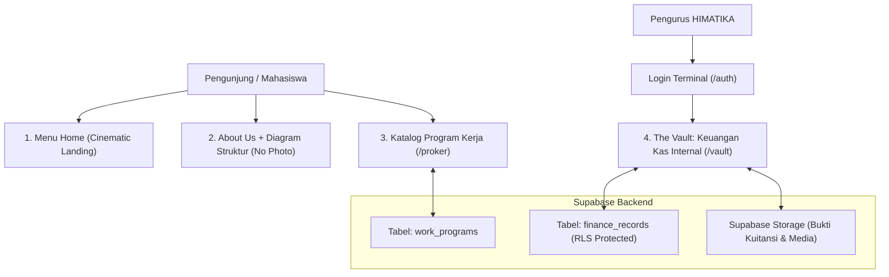
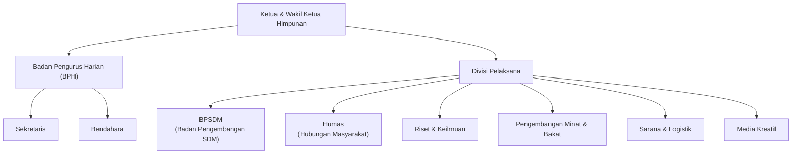
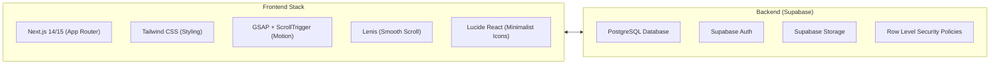

# PROJECT BLUEPRINT: HIMATIKA REVAMP 2026/2027
> **Dokumen Arsitektur, Desain, & Spesifikasi Teknis Pembaruan Website Himpunan Mahasiswa Teknik Informatika (HIMATIKA)**  
> **Status:** Draft Perencanaan & Brainstorming (Menunggu Eksekusi)  
> **Target Release:** 2026/2027 Period  

---

## 1. Ringkasan Eksekutif & Tujuan Proyek

### 1.1 Konteks Proyek
Website HIMATIKA sebelumnya merupakan website profil berbasis HTML/CSS statis konvensional dengan tampilan korporat kampus standar (terang/biru klasik). Proyek pembaruan ini bertujuan untuk melakukan **rebuild menyeluruh** (*total overhaul*) guna menciptakan identitas digital yang merepresentasikan mahasiswa Teknik Informatika: **futuristik, sinematik, berpresisi tinggi, dan berbasis teknologi terkini**.

### 1.2 Tujuan Utama (*Core Objectives*)
1. **Elevasi Identitas Visual (*Awwwards Standard*)**: Mengadopsi bahasa desain *Cinematic Brutalist-Editorial* terinspirasi dari [mikkisindhunata.com](https://mikkisindhunata.com/) dengan palet *dark noir*, tipografi masif, dan animasi fluid.
2. **Representasi Struktur Modern**: Menampilkan bagan struktur kepengurusan menggunakan **Interactive Node / Blueprint Diagram** (tanpa foto personal anggota), memberikan kesan teknikal dan rapi.
3. **Showcase Program Kerja Terpusat**: Membangun katalog program kerja interaktif di halaman khusus (`/proker`) dengan status penayangan, filter divisi, dan panel rincian.
4. **Sistem Transparansi Keuangan Internal (The Vault)**: Mengintegrasikan database **Supabase (PostgreSQL)** dengan sistem autentikasi tertutup (*Restricted Access*) untuk pencatatan dan pelaporan kas masuk/keluar khusus pengurus HIMATIKA.
5. **Responsif Multi-Platform (100% Mobile & Desktop Ready)**: Menjamin pengalaman mulus di berbagai perangkat (Smartphone, Tablet, Laptop, Desktop Wide).
6. **Platform Deployment**: Menggunakan **Vercel** sebagai infrastruktur hosting serverless & Edge Network resmi.

---

## 2. Bahasa Desain & Analisis Referensi (`mikkisindhunata.com`)

### 2.1 Pilar Estetika
* **Atmosphere**: *Cinematic Dark Noir & Cyber-Minimalism*. Kontras tinggi antara latar belakang hitam pekat dan tipografi putih bersih dengan aksen cyber.
* **Layout**: *Edge-to-Edge Composition*. Memanfaatkan ruang layar secara optimal dengan pembatas garis transparan tipis (`1px border rgba(255,255,255,0.08)`).
* **Motion Experience**:
  * **Smooth Scroll**: Menggunakan engine Lenis untuk sensasi scroll berbobot dan melayang.
  * **Text Scramble Effect**: Teks navigasi dan judul beranimasi acak/decoding karakter ala terminal saat kursor mendekat.
  * **Split Text Reveals**: Animasi kemunculan judul huruf-demi-huruf saat elemen masuk ke viewport.

### 2.2 Hierarki Tipografi
| Peran Tipografi | Font Family | Karakter & Kegunaan |
| :--- | :--- | :--- |
| **Headline / Display** | `Anton SC` / `Syne` | Huruf kapital, tebal, proporsi besar (`clamp(2.5rem, 7vw, 6rem)`). Memberikan kesan berani dan dramatis. |
| **Technical Metadata** | `JetBrains Mono` / `B612 Mono` | Monospaced, tracking lebar. Digunakan untuk nomor urut (`01 / 06`), tanggal, label badge, dan data angka. |
| **Body Text** | `Poppins` / `Inter` | Bersih, keterbacaan tinggi, kontras abu-abu lembut (`#a1a1aa`) untuk deskripsi panjang. |

### 2.3 Palet Warna (Color System)
```css
:root {
  --bg-primary: #050505;        /* Deep Obsidian Black */
  --bg-secondary: #0f0f11;      /* Charcoal Card Background */
  --text-primary: #f4f4f5;      /* Pure Crisp White */
  --text-muted: #71717a;        /* Monospace Technical Gray */
  --accent-cyan: #00e5ff;       /* Electric Cyber Cyan (Status Active / Highlights) */
  --accent-blue: #0066ff;       /* HIMATIKA Identity Blue */
  --border-subtle: rgba(255, 255, 255, 0.08); /* Minimalist Hairline Borders */
}
```

---

## 3. Cakupan Fitur & Spesifikasi Halaman



### 3.1 Halaman Beranda (Menu Home)
* **Navbar Minimalis Melayang**: Posisikan di tepi atas, transparan, menyebar kiri (`HIMATIKA TRILOGI`), tengah (`STATUS: ACTIVE 2026/2027`), dan kanan (Menu Tautan). Efek *text scramble* saat hover.
* **Hero Section Sinematik**:
  * Teks raksasa: `HIMATIKA TRILOGI` & `DEPT. OF INFORMATICS`.
  * Background video looping gerak lambat (dokumentasi makrab, coding session, seminar) dalam format kompresi `.webm` ringan berbobot < 3MB.
  * Indikator scroll bawah beranimasi garis linear.
* **Featured Showcase Slider**: Slider 3-4 program kerja unggulan dengan nomor urut besar (`PROG // 01`), progress bar tipis, dan tombol interaktif yang responsif swipe di mobile.

### 3.2 Halaman Tentang Kami & Struktur Organisasi (About Us)
* **Kilas Sejarah & Nilai**: Sejarah pendirian (2015), Visi, dan Misi disajikan dalam layout dua kolom tipografi bergaya editorial.
* **Interactive Node/Blueprint Diagram (Tanpa Foto Anggota)**:
  * Menggantikan deretan kartu foto konvensional dengan **diagram silsilah/hierarki interaktif** mirip bagan arsitektur software / branch Git.
  * **Hierarki Resmi Kepengurusan HIMATIKA**:
    * **Top Level**: `Ketua Himpunan` & `Wakil Ketua Himpunan`
    * **Badan Pengurus Harian (BPH)**:
      * ⚖️ `Sekretaris` (Administrasi, persuratan, dan tata kelola arsip)
      * 💰 `Bendahara` (Pengelolaan kas, anggaran proker, dan pelaporan keuangan)
    * **Divisi Operasional & Departemen**:
      * 👥 `Badan Pengembangan Sumber Daya Manusia (BPSDM)` (Kaderisasi, pengembangan anggota, kepemimpinan)
      * 🌐 `Humas` (Hubungan masyarakat, relasi eksternal, kolaborasi ormawa/industri)
      * 🔬 `Riset dan Keilmuan` (Penelitian teknologi, workshop akademik, coding/kompetisi)
      * 🏆 `Pengembangan Minat dan Bakat` (Wadah minat non-akademik, olahraga, esports, seni)
      * 📦 `Sarana dan Logistik` (Pengelolaan inventaris, perlengkapan teknis, kebutuhan acara)
      * 🎨 `Media Kreatif` (Desain grafis, publikasi medsos, branding visual, dokumentasi)



  * **Fitur Interaktif**: Mengklik/tap pada node divisi akan memunculkan laci detail (*drawer*) yang menampilkan deskripsi tugas pokok & fungsi (tupoksi), nama kepala divisi, dan daftar anggota aktif.
  * **Responsif**: Di layar desktop berbentuk bagan pohon horizontal/blueprint; di layar smartphone bertransformasi menjadi akordeon hierarkis rapi yang mudah di-tap.

### 3.3 Halaman Khusus Program Kerja (`/proker`)
* **Katalog Komprehensif**: Menampilkan semua program kerja HIMATIKA sepanjang periode kepengurusan.
* **Filter Kategori**:
  * Berdasarkan status: `Semua`, `Akan Datang (Upcoming)`, `Sedang Berjalan (Ongoing)`, `Terlaksana (Completed)`.
  * Berdasarkan divisi penanggung jawab.
* **Detail Card & Drawer**:
  * Menampilkan tanggal pelaksanaan, sasaran peserta, deskripsi tujuan, serta lampiran dokumentasi kegiatan (setelah terlaksana).
  * Data terhubung secara dinamis dari tabel Supabase `work_programs`.

### 3.4 Modul Keuangan Internal (The Vault / `/vault`)
* **Akses Terbatas (*Restricted Access*)**:
  * Halaman login bertema *Security Clearance Terminal*.
  * Menggunakan **Supabase Auth** (email/password terdaftar untuk pengurus himpunan).
* **Keamanan Data (Row Level Security - RLS)**:
  * Pengunjung umum tidak memiliki hak akses baca (`SELECT`) ke tabel keuangan.
* **Dashboard Finansial**:
  * **Summary Metrics**: Saldo Kas Aktif, Total Pemasukan Periode Ini, Total Pengeluaran Periode Ini.
  * **Tabel Transaksi Kas**: Daftar arus kas masuk/keluar per tanggal, nama kegiatan/keperluan, nominal, dan penanggung jawab input.
  * **Verifikasi Bukti Kuitansi**: Dukungan upload dan preview foto nota/kuitansi digital yang disimpan di Supabase Storage (Private Bucket).

### 3.5 UI/UX Standards ("Jos Los Gandos")
* **Performa Tinggi**: Skor Google Lighthouse > 90 untuk Performance, Accessibility, dan SEO.
* **Micro-Interactions**: Transisi halaman instan, kursor magnetik di desktop, feedback sentuhan haptik/visual di mobile.
* **Dark Mode Native**: Tidak memerlukan toggle light-mode yang merusak estetika; dark-mode dibangun secara permanen dan nyaman di mata (ramah layar OLED).

---

## 4. Spesifikasi Arsitektur Teknologi (Tech Stack)



* **Core Framework**: **Next.js (App Router)**
  * Memungkinkan halaman publik di-render dengan efisiensi tinggi (Server Components / ISR), sementara dashboard keuangan diamankan di level server menggunakan `@supabase/ssr`.
* **CSS Engine**: **Tailwind CSS**
  * Memudahkan penggunaan utilitas tipografi dinamis, flex/grid modern, dan custom theme dark noir.
* **Animasi & Interaksi**: **GSAP (ScrollTrigger, SplitType) + Lenis**
  * Standar industri untuk motion web kreatif kelas dunia.
* **Database & Cloud Services**: **Supabase**
  * Menggantikan Firebase sebelumnya. Menyediakan database relasional PostgreSQL, otentikasi aman, dan media storage.

---

## 5. Perancangan Skema Database (Supabase DDL)

Berikut rancangan skrip migrasi SQL siap pakai untuk Supabase:

```sql
-- ========================================================
-- 1. EXTENSIONS & ENUMS
-- ========================================================
create extension if not exists "uuid-ossp";

create type proker_status as enum ('upcoming', 'ongoing', 'completed');
create type finance_type as enum ('income', 'expense');

-- ========================================================
-- 2. TABEL STRUKTUR & ORGANISASI (Untuk Diagram)
-- ========================================================
create table divisions (
  id uuid primary key default gen_random_uuid(),
  code text unique not null,               -- misal: 'BPH', 'LITBANG', 'KOMINFO'
  name text not null,                      -- misal: 'Divisi Penelitian & Pengembangan'
  short_desc text,
  leader_name text not null,               -- Nama Ketua Divisi
  members text[] default '{}',             -- Array nama anggota
  order_index int default 0
);

-- ========================================================
-- 3. TABEL PROGRAM KERJA (Untuk Katalog /proker)
-- ========================================================
create table work_programs (
  id uuid primary key default gen_random_uuid(),
  title text not null,
  slug text unique not null,
  division_id uuid references divisions(id) on delete set null,
  status proker_status default 'upcoming',
  highlight_number text,                   -- misal: '01', '02'
  short_desc text not null,
  full_content text,                       -- Format Markdown untuk detail acara
  execution_date date,
  cover_video_url text,                    -- Video teaser loop (WebM)
  cover_image_url text,
  is_featured boolean default false,       -- Tampil di slider beranda
  created_at timestamp with time zone default now()
);

-- ========================================================
-- 4. TABEL KEUANGAN INTERNAL (The Vault - RLS Protected)
-- ========================================================
create table finance_categories (
  id uuid primary key default gen_random_uuid(),
  name text not null,                      -- misal: 'Iuran Kas', 'Sponsor', 'Konsumsi'
  type finance_type not null
);

create table finance_records (
  id uuid primary key default gen_random_uuid(),
  title text not null,                     -- Keterangan transaksi
  amount numeric(12, 2) not null,          -- Jumlah uang
  type finance_type not null,              -- 'income' atau 'expense'
  category_id uuid references finance_categories(id) on delete set null,
  transaction_date date not null,
  recorded_by uuid references auth.users(id),
  receipt_url text,                        -- URL bukti kuitansi di Supabase Storage
  notes text,
  created_at timestamp with time zone default now()
);

-- ========================================================
-- 5. ROW LEVEL SECURITY (RLS) POLICIES
-- ========================================================
-- Public dapat melihat divisi dan proker
alter table divisions enable row level security;
create policy "Divisi dapat dibaca publik" on divisions for select using (true);

alter table work_programs enable row level security;
create policy "Proker dapat dibaca publik" on work_programs for select using (true);

-- Keuangan HANYA dapat dibaca oleh pengguna login (pengurus)
alter table finance_records enable row level security;
create policy "Data kas hanya untuk pengurus terdaftar" 
on finance_records for all 
to authenticated 
using (true)
with check (true);

-- ========================================================
-- 6. SEED DATA DIVISI RESMI HIMATIKA
-- ========================================================
insert into divisions (code, name, leader_name, short_desc, order_index) values
  ('BPH_SEK', 'Sekretaris', 'TBA', 'Tata kelola administrasi, kearsipan, dan persuratan organisasi.', 1),
  ('BPH_BEN', 'Bendahara', 'TBA', 'Pengelolaan kas, perencanaan anggaran, dan transparansi keuangan.', 2),
  ('BPSDM', 'Badan Pengembangan Sumber Daya Manusia', 'TBA', 'Kaderisasi, pembinaan karakter, dan peningkatan kapasitas internal pengurus.', 3),
  ('HUMAS', 'Hubungan Masyarakat', 'TBA', 'Menjalin relasi strategis dengan pihak eksternal, ormawa lain, dan industri teknologi.', 4),
  ('RISET', 'Riset dan Keilmuan', 'TBA', 'Pengembangan akademik, riset teknologi, kajian ilmiah, dan persiapan kompetisi IT.', 5),
  ('PMB', 'Pengembangan Minat dan Bakat', 'TBA', 'Fasilitasi minat non-akademik mahasiswa seperti olahraga, seni, dan komunitas hobi/esports.', 6),
  ('SARLOG', 'Sarana dan Logistik', 'TBA', 'Pengelolaan inventaris, fasilitas kesekretariatan, dan kebutuhan operasional acara.', 7),
  ('MEDKRAF', 'Media Kreatif', 'TBA', 'Branding visual, desain grafis, pengelolaan media sosial resmi, dan dokumentasi multimedia.', 8)
on conflict (code) do nothing;
```

---

## 6. Struktur Direktori Proyek Baru

Struktur direktori standar Next.js yang disiapkan untuk menampung seluruh fitur:

```text
himatika_web/
├── archive/                     # File web lama (index.html, style.css) disimpan sebagai cadangan
│   ├── index.html
│   └── style/
├── public/                      # Asset statis yang dapat diakses publik
│   ├── image/                   # Foto dokumentasi lama & logo HIMATIKA
│   │   ├── Logo Himatika.png
│   │   ├── t-camp.jpg
│   │   └── ...
│   ├── fonts/                   # Font lokal (Anton SC, JetBrains Mono)
│   └── videos/                  # Video loop ringkas untuk hero section
├── src/
│   ├── app/                     # Next.js App Router
│   │   ├── (public)/            # Route Group Publik
│   │   │   ├── page.tsx         # Halaman Beranda (Cinematic Hero + Teaser Proker)
│   │   │   ├── about/           # Halaman Tentang Kami & Interactive Diagram
│   │   │   └── proker/          # Halaman Khusus Katalog Proker
│   │   │       ├── page.tsx
│   │   │       └── [slug]/      # Detail satu program kerja
│   │   ├── (auth)/              # Route Group Autentikasi
│   │   │   └── login/           # Halaman Login Terminal Pengurus
│   │   ├── (private)/           # Route Group Khusus Internal
│   │   │   └── vault/           # Dashboard Keuangan Kas Himatika
│   │   ├── api/                 # Endpoint integrasi jika diperlukan
│   │   ├── layout.tsx           # Global Layout (Navbar, Smooth Scroll Wrapper)
│   │   └── globals.css          # Tailwind CSS & Keyframes
│   ├── components/
│   │   ├── ui/                  # Komponen UI Dasar (Buttons, Badges, Drawers)
│   │   ├── home/                # Komponen Beranda (HeroVideo, ScrambleHeader)
│   │   ├── diagram/             # Interactive Org Chart Component
│   │   ├── proker/              # ProkerCard, ProkerFilter, ProkerModal
│   │   └── vault/               # CashflowChart, TransactionTable, ReceiptViewer
│   ├── lib/
│   │   ├── supabase/            # Client & Server Helper Supabase
│   │   │   ├── client.ts
│   │   │   └── server.ts
│   │   └── motion/              # Konfigurasi GSAP & Lenis
│   └── types/                   # TypeScript interfaces (Database Types)
├── PROJECT.md                   # Dokumen Blueprint ini
└── package.json
```

---

## 7. Rencana Tahapan Eksekusi (Roadmap Milestones)

| Fase | Nama Fase | Fokus Pengerjaan |
| :--- | :--- | :--- |
| **Fase 1** | **Fondasi & Inisialisasi** | Inisialisasi Next.js (App Router), integrasi Tailwind, konfigurasi font Google (`Anton SC` & `JetBrains Mono`), dan integrasi Lenis smooth scroll. |
| **Fase 2** | **Landing Page Sinematik** | Pengerjaan Header fixed dengan efek *text scramble*, Hero section dengan video loop background, dan teaser carousel proker. |
| **Fase 3** | **About & Interactive Diagram** | Pembangunan halaman About Us dan modul visual diagram struktur organisasi (Node hierarchy tanpa foto) yang responsif. |
| **Fase 4** | **Katalog Proker & Supabase** | Pembuatan halaman `/proker`, penghubungan data dinamis dari Supabase `work_programs`, dan sistem drawer detail proker. |
| **Fase 5** | **The Vault (Keuangan Kas Internal)** | Pembuatan antarmuka login terminal, konfigurasi Supabase Auth & RLS, form input kas masuk/keluar, dan dashboard pelaporan. |
| **Fase 6** | **Polish, Mobile Audit, & Launch** | Audit performa di berbagai smartphone, kompresi aset gambar/video, uji coba keamanan data kas, dan deploy. |

---

## 8. Status & Kemajuan Proyek Terkini

Status Kesiapan:
* [x] **Daftar Divisi Resmi**: Sudah terkonfirmasi 8 entitas resmi HIMATIKA.
* [x] **Runtime Lokal**: Node.js LTS (`v24.20.0`) dan NPM (`v11.19.0`) aktif di mesin lokal.
* [x] **Koneksi Supabase MCP**: Terhubung ke proyek **`Website_Himatika`** (`urlpknogetgjfmwdbymk`).
* [x] **Skema Basis Data Supabase**: 4 tabel (`divisions`, `work_programs`, `finance_categories`, `finance_records`), RLS security, 2 storage bucket (`public-assets`, `vault-receipts`), database view, dan RPC function berhasil dideploy.
* [x] **Platform Hosting Terpilih**: Vercel (Edge Serverless).
* [x] **Fase 1 Selesai (Fondasi Next.js)**: App Router, Tailwind 4, Google Fonts (`Anton`, `JetBrains_Mono`, `Poppins`), Supabase SSR helpers, middleware route guard, dan build produksi diverifikasi sukses tanpa error.
* [x] **Fase 3 Selesai (Halaman Beranda Sinematik)**: Hero Section dengan analog film grain & video loop background, massive display lockup Anton SC, Featured Showcase Slider proker split-screen dengan touch swipe & linear progress, serta Quick Metrics blueprint.
* [ ] **Langkah Selanjutnya**: Siap eksekusi **FASE 4 (Halaman Tentang Kami: Interactive Org Blueprint / Node Tree Diagram Tanpa Foto)**.

*(Dokumen ini akan terus diperbarui seiring berjalannya proyek).*
